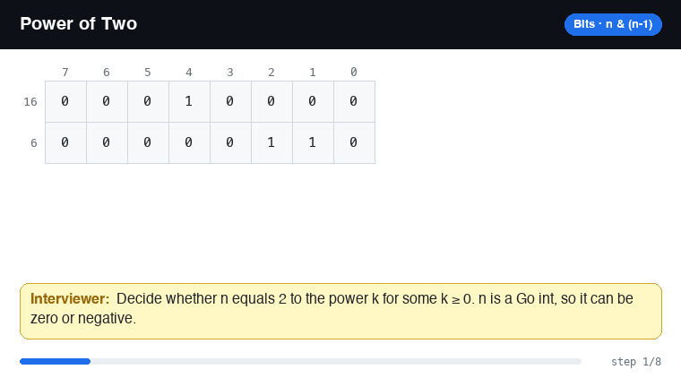

# Walkthrough: Power of Two

**Module:** [18 · Bit Manipulation](../README.md) · **Difficulty:** Easy · **Solution:** [`p03_power_of_two.go`](../p03_power_of_two.go)



## The problem in plain words

Is the number one of 1, 2, 4, 8, 16, …? In other words, is it 2 multiplied by itself some number of times (including zero times, which gives 1)?

```
1  →  true  (2⁰)
16 →  true
6  →  false
0, -8 →  false
```

## Mock interview

**Interviewer:** Decide whether `n` equals 2ᵏ for some integer k ≥ 0.

**Candidate:** `n` is a Go `int`, so 64 bits and possibly zero or negative. Zero and negatives are never powers of two, right?

**Interviewer:** Right.

**Candidate:** 1 and 16 are true. 6 is false. 0 and -8 are false. The tricky inputs are the non-positive ones.

**Candidate:** The simple way: if `n <= 0`, return false. Otherwise divide by 2 while `n` is even, and check that I end at 1. That's O(log n).

**Interviewer:** Can you do it in constant time?

**Candidate:** In binary, a power of two has exactly one 1 bit. `n & (n-1)` clears the lowest 1 bit. So the result is 0 exactly when `n` had a single 1. The check is `n > 0 && n&(n-1) == 0`.

**Interviewer:** Why do you need `n > 0`?

**Candidate:** Two reasons. For `n = 0`, `0 & -1` is 0, so the bit test would pass. And `math.MinInt` has only one 1 bit, the sign bit, so it would pass too. The guard rules out both. Other negatives like -8 have many 1s in two's complement and fail anyway, but the guard makes the intent clear.

**Candidate:** In code it's one line: `return n > 0 && n&(n-1) == 0`.

**Candidate:** Testing it: 1 is `0001`; `1 & 0 = 0`, so true. 16 is `10000`; `16 & 15 = 0`, so true. 6 is `110`; `6 & 5 = 100`, which is 4, so false. 0 fails the guard. -8 fails the guard.

**Interviewer:** Complexity?

**Candidate:** One subtraction, one AND and two compares: **O(1) time and O(1) space.**

**Interviewer:** How would you test for a power of four?

**Candidate:** It must be a power of two whose single bit sits at an even position: bit 0, 2, 4, and so on. So I also check `n & 0x5555_5555_5555_5555 != 0`. That's `IsPowerOfFour` in the repo.

## What the animation shows

| Step | Input | Check | Result |
|---|---|---|---|
| 1 | | Interviewer states the problem | |
| 2 | | Divide-by-2 loop is O(log n); a power of two has one 1 bit | |
| 3 | 1 | `1 & 0 = 0` | true |
| 4 | 16 | `16 & 15 = 0` | true |
| 5 | 6 | `6 & 5 = 4 ≠ 0` | false |
| 6 | 0 | `n > 0` fails | false |
| 7 | -8 | `n > 0` fails | false |
| 8 | | The full test: `n > 0 && n&(n-1) == 0`; O(1) | |

The animation traces every example from the doc comment, since the first one alone (1) doesn't show the trick. Bit rows show the low 8 bits. -8 is drawn in 8-bit two's complement (`11111000`); as a 64-bit `int` the extra high bits are also 1.

## Detailed explanation

For `n > 0`, write `n` as `X10…0`: higher bits `X`, then the lowest 1, then zeros. `n - 1` is `X01…1`, and `n & (n-1)` is `X00…0`. That's 0 exactly when `X` is 0, which means the lowest 1 was the only 1. A positive number with a single 1 bit at position k is 2ᵏ.

For `n ≤ 0`, the answer is always false, and the bit test alone could get it wrong:

- `n = 0`: `0 & (0 - 1) = 0 & -1 = 0`, so the bit test says yes.
- `n = math.MinInt`: the bit pattern is `100…0`. `n - 1` wraps around to `math.MaxInt`, which is `011…1`. The AND is 0, so the bit test says yes.

The `n > 0` guard handles both.

## Complexity

| Approach | Time | Space |
|---|---|---|
| Divide while even (`IsPowerOfTwoLoop`) | O(log n) | O(1) |
| Single-bit test (`IsPowerOfTwo`) | O(1) | O(1) |
| Power of four (`IsPowerOfFour`) | O(1) | O(1) |

## Common mistakes

- Leaving out `n > 0`, which makes 0 and `math.MinInt` return true.
- Writing `n & n-1 == 0` in a language where `==` binds tighter than `&`. In Go, `&` binds tighter than `==`, so `n&(n-1) == 0` is correct, but the parentheses around `n-1` are still worth keeping for readers.
- Using floating-point `math.Log2` and checking for a whole number. Rounding errors make this unreliable for large inputs.

## Try it yourself

```sh
go test ./course/18-bit-manipulation/ -run TestIsPowerOfTwo -v
```
