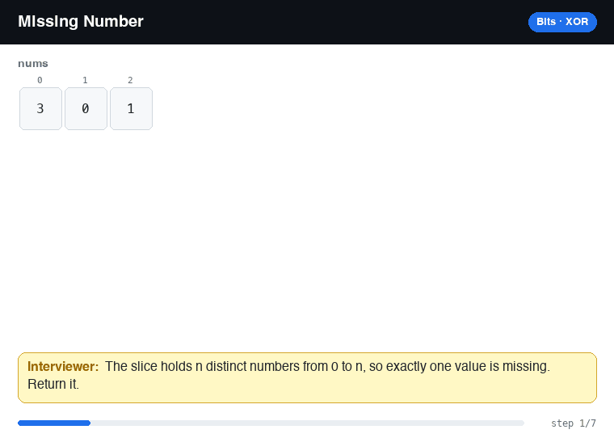

# Walkthrough: Missing Number

**Module:** [18 · Bit Manipulation](../README.md) · **Difficulty:** Easy · **Solution:** [`p04_missing_number.go`](../p04_missing_number.go)



## The problem in plain words

A list of length n holds different numbers taken from 0 to n. That range has n + 1 numbers, so exactly one is missing. Find it.

```
[3, 0, 1]                    →  2
[9, 6, 4, 2, 3, 5, 7, 0, 1]  →  8
[0]                          →  1
```

## Mock interview

**Interviewer:** A slice holds n distinct numbers from the range 0 to n. Return the one that's missing.

**Candidate:** Could the missing number be n itself? Like `[0]` gives 1?

**Interviewer:** Yes.

**Candidate:** For `[3, 0, 1]`, n is 3, so the range is 0 to 3, and 2 is missing. For `[0]`, n is 1 and the missing value is 1.

**Candidate:** The first idea is a `seen` slice of n + 1 booleans. Mark each value, then find the false one. That's O(n) time and O(n) space. Another idea is the Gauss sum: `n(n+1)/2` minus the sum of the slice. That's O(1) space, but the sum can overflow in fixed-width integers for very large n.

**Interviewer:** Is there an O(1)-space way that can't overflow?

**Candidate:** XOR. If I XOR all the numbers from 0 to n together with all the values in the slice, every present number shows up twice and cancels. The missing number shows up once, so it's what remains. I get 0 to n-1 for free from the indices, so I start the accumulator at n.

**Interviewer:** Why start at n and not 0?

**Candidate:** The loop's indices only go to n - 1. Starting at n adds the last number of the range. Without it, the answer would be wrong whenever n is present.

**Candidate:** In code: `acc := len(nums)`, then `for i, x := range nums { acc ^= i ^ x }`, then `return acc`.

**Candidate:** Testing it: acc starts at 3. Index 0, value 3: `3 ^ 0 ^ 3 = 0`. Index 1, value 0: `0 ^ 1 ^ 0 = 1`. Index 2, value 1: `1 ^ 2 ^ 1 = 2`. The answer is 2.

**Interviewer:** Complexity?

**Candidate:** One pass and one integer: **O(n) time and O(1) space.**

**Interviewer:** Is the Gauss sum really a problem in Go?

**Candidate:** For a 64-bit `int`, `n(n+1)/2` overflows only when n is around 4 billion or more, which won't fit in memory as a slice anyway. And Go's overflow wraps, so the subtraction would still give the right answer. XOR just avoids having to argue about it.

## What the animation shows

| Step | Index `i` | Value `x` | `acc` after |
|---|---|---|---|
| 1 | Interviewer states the problem on `[3, 0, 1]` | | |
| 2 | Seen table needs O(n) space; Gauss sum can overflow | | |
| 3 | Start: `acc = n = 3` | | 3 |
| 4 | 0 | 3 | `3 ^ 0 ^ 3 = 0` |
| 5 | 1 | 0 | `0 ^ 1 ^ 0 = 1` |
| 6 | 2 | 1 | `1 ^ 2 ^ 1 = 2` |
| 7 | Answer 2; O(n) time, O(1) space | | 2 |

The bit rows show the low 8 bits of each number.

## Detailed explanation

After the loop, `acc` is the XOR of `n`, every index `0 … n-1`, and every value. Together, the first two give each number in `0 … n` once. The values give each number in `0 … n` once, except the missing one. So every number except the missing one appears twice and cancels, and XOR leaves the missing number.

As in Single Number, order doesn't matter. The intermediate values of `acc` don't mean anything on their own; only the final result does.

Edge cases:

- **Missing number is n.** Like `[0]`: `acc = 1 ^ 0 ^ 0 = 1`.
- **Missing number is 0.** Like `[1]`: `acc = 1 ^ 0 ^ 1 = 0`.

## Complexity

| Approach | Time | Space |
|---|---|---|
| Seen table (`MissingNumberSeen`) | O(n) | O(n) |
| Gauss sum (`MissingNumberSum`) | O(n) | O(1) |
| XOR indices with values (`MissingNumber`) | O(n) | O(1) |

## Common mistakes

- Starting `acc` at 0, which leaves out n. The answer is then wrong whenever n is in the slice.
- Sorting and scanning for the gap. That works but costs O(n log n).
- Assuming the missing number is always inside the slice's value range.

## Try it yourself

```sh
go test ./course/18-bit-manipulation/ -run TestMissingNumber -v
```
