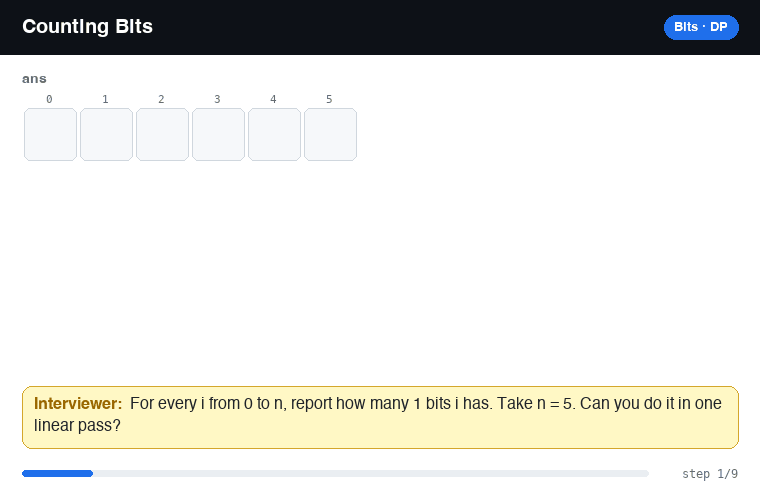

# Walkthrough: Counting Bits

**Module:** [18 · Bit Manipulation](../README.md) · **Difficulty:** Easy · **Solution:** [`p05_counting_bits.go`](../p05_counting_bits.go)



## The problem in plain words

For every number from 0 up to n, count how many 1s it has in binary. Return all the counts in a list.

```
n = 2  →  [0 1 1]
n = 5  →  [0 1 1 2 1 2]
```

## Mock interview

**Interviewer:** For every integer `i` from 0 to n inclusive, return how many 1 bits `i` has. Try to do it in one linear pass.

**Candidate:** So the result has n + 1 entries, and n is never negative?

**Interviewer:** Yes.

**Candidate:** For n = 5: 0 is `0`, 1 is `1`, 2 is `10`, 3 is `11`, 4 is `100`, 5 is `101`. The counts are `[0 1 1 2 1 2]`.

**Candidate:** The naive way runs a popcount on each number. With a bit-by-bit popcount, that's O(n · bits). With `bits.OnesCount` it's fast in practice, but the interviewer usually wants a recurrence.

**Interviewer:** Can you reuse earlier answers?

**Candidate:** Yes. `i & (i-1)` is `i` with its lowest 1 bit cleared. It's smaller than `i`, so I've already computed its count. And `i` has exactly one more 1 bit. So `ans[i] = ans[i & (i-1)] + 1`, with `ans[0] = 0`.

**Interviewer:** Is there another recurrence?

**Candidate:** `ans[i] = ans[i >> 1] + (i & 1)`. Shifting right drops the last bit, and `i & 1` adds it back. That's `CountBitsShift`. Both are O(n).

**Candidate:** In code: `ans := make([]int, n+1)`, then `for i := 1; i <= n; i++ { ans[i] = ans[i&(i-1)] + 1 }`.

**Candidate:** Testing it: `1 & 0 = 0`, so ans[1] = 1. `2 & 1 = 0`, so ans[2] = 1. `3 & 2 = 2`, so ans[3] = ans[2] + 1 = 2. `4 & 3 = 0`, so ans[4] = 1. `5 & 4 = 4`, so ans[5] = ans[4] + 1 = 2. The result is `[0 1 1 2 1 2]`.

**Interviewer:** Complexity?

**Candidate:** One AND and one lookup per number: **O(n) time.** The only space is the output, **O(n)**.

**Interviewer:** Why is the `i & (i-1)` index always ready?

**Candidate:** Clearing a 1 bit makes the number strictly smaller, and I fill the table from small to large.

## What the animation shows

| Step | `i` | `i & (i-1)` | `ans[i]` |
|---|---|---|---|
| 1 | Interviewer states the problem with n = 5 | | |
| 2 | Naive: popcount each number separately | | |
| 3 | `ans[0] = 0`; recurrence `ans[i] = ans[i & (i-1)] + 1` | | |
| 4 | 1 | 0 | 0 + 1 = 1 |
| 5 | 2 | 0 | 0 + 1 = 1 |
| 6 | 3 | 2 | 1 + 1 = 2 |
| 7 | 4 | 0 | 0 + 1 = 1 |
| 8 | 5 | 4 | 1 + 1 = 2 |
| 9 | Answer `[0 1 1 2 1 2]`; O(n) time, O(n) space | | |

The animation uses the doc comment's second example, n = 5. The first example, n = 2, is too short to show a lookup that isn't `ans[0]`. Bit rows show the low 8 bits.

## Detailed explanation

This is a DP where the "smaller subproblem" is chosen by a bit trick. For `i > 0`, write `i` as `X10…0`. Then `i & (i-1)` is `X00…0`, which has the same bits as `i` minus exactly one. So `popcount(i) = popcount(i & (i-1)) + 1`.

Powers of two are the case where `X` is empty: `i & (i-1) = 0`, so the count is 1. You can see it in the table at i = 1, 2 and 4.

Edge cases:

- **n = 0.** The loop doesn't run; the result is `[0]`.
- **Large n.** The result needs n + 1 ints, which is the real limit.

## Complexity

| Approach | Time | Space |
|---|---|---|
| Popcount each number (`CountBitsNaive`) | O(n) with hardware popcount, O(n · bits) by hand | O(n) output |
| Half plus last bit (`CountBitsShift`) | O(n) | O(n) output |
| Drop the lowest set bit (`CountBits`) | O(n) | O(n) output |

## Common mistakes

- Allocating `n` entries instead of `n + 1`.
- Writing `ans[i>>1] + i&1` and worrying about precedence. In Go, `&` binds tighter than `+`, so `ans[i>>1] + i&1` is `ans[i>>1] + (i&1)`, as intended. In C or Java it isn't, so add parentheses there.
- Starting the loop at 0. Then `ans[0] = ans[0 & -1] + 1 = 1`, which is wrong, and every later entry inherits the error.

## Try it yourself

```sh
go test ./course/18-bit-manipulation/ -run TestCountBits -v
```
