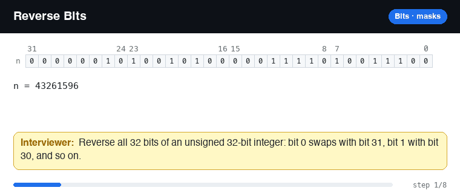

# Walkthrough: Reverse Bits

**Module:** [18 · Bit Manipulation](../README.md) · **Difficulty:** Easy · **Solution:** [`p06_reverse_bits.go`](../p06_reverse_bits.go)



## The problem in plain words

Take a 32-bit unsigned number, write out all 32 bits (leading zeros included), and read them backwards. Return the number you get.

```
0b00000010100101000001111010011100  →  0b00111001011110000010100101000000
1                                   →  0x80000000
```

## Mock interview

**Interviewer:** Reverse the order of all 32 bits of a `uint32`: bit 0 swaps with bit 31, bit 1 with bit 30, and so on.

**Candidate:** The width is fixed at 32, so leading zeros count? For example, 1 becomes `0x80000000`?

**Interviewer:** Yes. The type is `uint32`, not Go's 64-bit `int`.

**Candidate:** For the first example, 43261596, reading the 32 bits backwards gives 964176192. And 1 has its only bit at position 0, which moves to position 31.

**Candidate:** The straightforward way is a loop. Pop the low bit of `n` and push it onto the low end of `out`: `out = out<<1 | n&1`, then `n >>= 1`. After 32 steps, the first bit I popped is at the top. That's 32 iterations and O(1) space.

**Interviewer:** Can you stop when `n` becomes 0?

**Candidate:** No. The remaining zeros still need to shift `out` left. If I stop early, 1 would come out as 1 instead of `0x80000000`. The loop must run all 32 times.

**Interviewer:** Can you do it without a loop?

**Candidate:** Yes, divide and conquer with masks. To reverse 32 bits, swap the two 16-bit halves, then reverse inside each half. Reversing a half means swapping its two bytes, then reversing each byte, and so on down to single bits. Each level is one line: mask out the high blocks and shift them right, mask out the low blocks and shift them left, and OR them together. That's 5 lines for block sizes 16, 8, 4, 2, 1.

**Candidate:** The masks are `0xFF00FF00 / 0x00FF00FF` for bytes, `0xF0F0F0F0 / 0x0F0F0F0F` for nibbles, `0xCCCCCCCC / 0x33333333` for pairs, and `0xAAAAAAAA / 0x55555555` for single bits. The first step needs no mask: `n>>16 | n<<16`, because the shifts on a `uint32` drop the bits that fall off.

**Candidate:** Testing on the example: after swapping halves, the low half `0001111010011100` is on top. Then bytes, nibbles, pairs and neighbours. After the fifth step I get `0x39782940`, which is 964176192 and matches the expected output.

**Interviewer:** Complexity?

**Candidate:** Both are O(1) for a fixed width: **32 iterations for the loop, 5 steps for the masks, and O(1) space.** In real code I'd call `bits.Reverse32`.

**Interviewer:** What if you had to reverse many numbers?

**Candidate:** I could precompute a 256-entry table of reversed bytes. Then each number is four lookups: reverse each byte and put the bytes in the opposite order.

## What the animation shows

| Step | What happens |
|---|---|
| 1 | Interviewer states the problem on `n = 43261596` |
| 2 | Loop approach: 32 pop-and-push steps |
| 3 | Swap the 16-bit halves: `n>>16 \| n<<16` |
| 4 | Swap the bytes inside each half (mask `0xFF00FF00`, shift 8) |
| 5 | Swap the nibbles inside each byte (mask `0xF0F0F0F0`, shift 4) |
| 6 | Swap the pairs inside each nibble (mask `0xCCCCCCCC`, shift 2) |
| 7 | Swap neighbouring bits (mask `0xAAAAAAAA`, shift 1) |
| 8 | Answer 964176192 (`0x39782940`); 5 steps vs 32, O(1) space |

Each frame shows the 32 bits before and after the step. The colours mark the blocks: in the "after" row, each bit keeps the colour of the block it came from, so you can see the blocks trade places.

## Detailed explanation

Reversing a sequence of length 2m is the same as swapping its two halves and then reversing each half. Apply that rule five times and you reach blocks of length 1, which are already reversed. Each level does the swap for every block at once:

- `n & highMask` keeps the upper block of each pair, and `>> size` moves it down.
- `n & lowMask` keeps the lower block, and `<< size` moves it up.
- OR combines them, since they don't overlap.

Because a swap of adjacent blocks of size `s` sends bit position `p` to `p XOR s`, doing all five levels sends `p` to `p XOR 31 = 31 - p`. That's exactly the reversal.

The width matters. On a `uint32`, `n<<16` drops the top 16 bits. On a 64-bit value the same line would keep them, and the result would be wrong. Go's `uint32` type makes this safe.

## Complexity

| Approach | Time | Space |
|---|---|---|
| Shift loop (`ReverseBitsLoop`) | O(32) | O(1) |
| Mask swaps (`ReverseBits`) | O(5) | O(1) |
| Standard library (`ReverseBitsStdlib`) | O(1) | O(1) |

## Common mistakes

- Stopping the loop when `n == 0`, which loses the leading zeros.
- Mixing up the masks, for example using `0x55555555` for the high half of the pair. The high mask always has the 1s in the upper part of each block.
- Running the code on a signed or 64-bit type, so the shifted-out bits don't fall off.

## Try it yourself

```sh
go test ./course/18-bit-manipulation/ -run TestReverseBits -v
```
