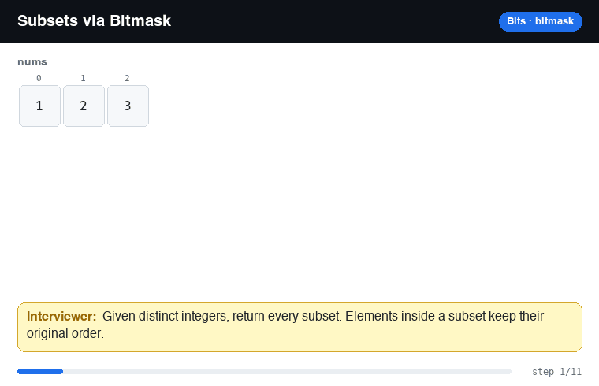

# Walkthrough: Subsets via Bitmask

**Module:** [18 · Bit Manipulation](../README.md) · **Difficulty:** Medium · **Solution:** [`p07_subsets_bitmask.go`](../p07_subsets_bitmask.go)



## The problem in plain words

Given a list of different numbers, list every possible group you can pick from it, including picking nothing and picking everything. Inside each group, keep the numbers in their original order.

```
[1, 2, 3]  →  [] [1] [2] [1 2] [3] [1 3] [2 3] [1 2 3]
[]         →  []
```

## Mock interview

**Interviewer:** Given distinct integers, return every subset. Elements inside a subset keep their original order.

**Candidate:** How large can the input be? The output has 2ⁿ subsets, so n has to be small.

**Interviewer:** n is at most about 20.

**Candidate:** For `[1, 2, 3]` there are 2³ = 8 subsets, from `[]` to `[1 2 3]`. For an empty input, the only subset is the empty one, so the result is `[[]]`.

**Candidate:** The usual way is backtracking: for each element, either include it or skip it, and recurse. That's O(n · 2ⁿ) time, which is the size of the output, so it can't be beaten. But it needs recursion.

**Interviewer:** Can you do it without recursion?

**Candidate:** Each subset is n yes/no choices, and an n-bit integer stores exactly that. Bit `i` of `mask` set means "include `nums[i]`". Counting `mask` from 0 to 2ⁿ - 1 visits every combination of bits once, so it lists every subset once.

**Interviewer:** How do you keep the original order inside each subset?

**Candidate:** For each mask I scan `i` from 0 to n-1 and append `nums[i]` when bit `i` is set. Lower indices come first.

**Candidate:** In code: `out := make([][]int, 0, 1<<n)`. The outer loop is `for mask := 0; mask < 1<<n; mask++`. Inside, `subset := []int{}`, and for each `i` I test `mask>>i&1 == 1`.

**Candidate:** Testing it: mask 0 is `000`, the empty set. Mask 1 is `001`, so `[1]`. Mask 2 is `010`, so `[2]`. Mask 3 is `011`, so `[1 2]`. Then `[3]`, `[1 3]`, `[2 3]` and `[1 2 3]` for masks 4 to 7. That's all 8.

**Interviewer:** Complexity?

**Candidate:** 2ⁿ masks, and n bit checks each: **O(n · 2ⁿ) time and space**, which is the output size.

**Interviewer:** What if I only want subsets of size k?

**Candidate:** I can jump straight from one k-bit mask to the next larger one with Gosper's hack: `low = mask & -mask`, `ripple = mask + low`, `ones = ((mask ^ ripple) >> 2) / low`, `next = ripple | ones`. That's `Combinations` in the repo. It visits only C(n, k) masks.

## What the animation shows

| Step | `mask` | Bits (bit 2, 1, 0) | Subset |
|---|---|---|---|
| 1 | Interviewer states the problem on `[1, 2, 3]` | | |
| 2 | Backtracking works; a mask can stand for a subset | | |
| 3 | 0 | `000` | `[]` |
| 4 | 1 | `001` | `[1]` |
| 5 | 2 | `010` | `[2]` |
| 6 | 3 | `011` | `[1 2]` |
| 7 | 4 | `100` | `[3]` |
| 8 | 5 | `101` | `[1 3]` |
| 9 | 6 | `110` | `[2 3]` |
| 10 | 7 | `111` | `[1 2 3]` |
| 11 | All 8 subsets; O(n · 2ⁿ) time and space | | |

The mask row shows only n = 3 bits, since higher bits are never used. Bit `i` sits under `nums[i]`.

## Detailed explanation

There is a one-to-one match between subsets of an n-element list and integers in `[0, 2ⁿ)`. Each subset has a unique set of chosen indices, and each set of indices is the set bits of exactly one integer. So counting through all integers lists all subsets, each exactly once.

The order of the output is by mask value, so it's not sorted by size. If a test compares against a different order, sort both sides first or compare as sets.

The `1<<n` bound limits n. On a 64-bit `int`, n can go up to 62 in theory, but 2²⁰ subsets is already about a million, and the output is what runs out of memory.

Edge cases:

- **Empty input.** `1<<0 = 1`, so the loop runs once with mask 0 and returns `[[]]`.
- **Each subset is a new slice.** `subset := []int{}` inside the loop makes sure the subsets don't share a backing array.

## Complexity

| Approach | Time | Space |
|---|---|---|
| Bitmask count (`Subsets`) | O(n · 2ⁿ) | O(n · 2ⁿ) output |
| k-subsets with Gosper's hack (`Combinations`) | O(n · C(n, k)) | O(k · C(n, k)) output |

## Common mistakes

- Reusing one `subset` slice across masks and appending it. Every entry ends up sharing the same memory.
- Writing `mask < n` instead of `mask < 1<<n`.
- Testing `mask & i` instead of `mask>>i & 1` (or `mask & (1<<i)`).

## Try it yourself

```sh
go test ./course/18-bit-manipulation/ -run TestSubsets -v
```
