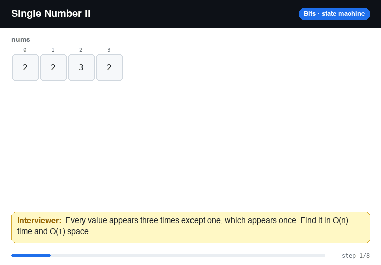

# Walkthrough: Single Number II

**Module:** [18 · Bit Manipulation](../README.md) · **Difficulty:** Medium · **Solution:** [`p08_single_number_ii.go`](../p08_single_number_ii.go)



## The problem in plain words

Every number in the list shows up exactly three times, except one number that shows up once. Find that one, in one pass, with constant extra memory.

```
[2, 2, 3, 2]             →  3
[0, 1, 0, 1, 0, 1, 99]   →  99
```

## Mock interview

**Interviewer:** Every value appears exactly three times except one, which appears once. Find it in linear time and constant space.

**Candidate:** Can the values be negative?

**Interviewer:** Yes.

**Candidate:** For `[2, 2, 3, 2]` the answer is 3. Plain XOR doesn't work here: three 2s XOR to 2, not 0, so I'd get `2 ^ 3 = 1`.

**Candidate:** A count map works in O(n) time but O(n) space. A constant-space idea: for each of the 64 bit positions, count how many numbers have that bit set. The triples add a multiple of 3, so `count % 3` is the single number's bit. That's O(64 · n) time and O(1) space. It's `SingleNumberIICount` in the repo.

**Interviewer:** Can you do it in one pass?

**Candidate:** Yes. I keep the count mod 3 for every bit position at once, using two words, `ones` and `twos`. For each bit position, the state is: seen 0 times (`ones=0, twos=0`), once (`1, 0`), twice (`0, 1`), and back to `0, 0` on the third time. These two lines step every bit's counter:

```go
ones = (ones ^ x) &^ twos
twos = (twos ^ x) &^ ones
```

**Interviewer:** Walk me through why those lines work.

**Candidate:** Look at one bit where `x` has a 1. From state `0,0`: `ones` flips to 1, and `twos` stays 0 because `ones` is now 1. From `1,0`: `ones` flips to 0, then `twos` flips to 1. From `0,1`: `ones` would flip to 1, but `&^ twos` clears it; then `twos` flips to 0. So the state goes 0 → 1 → 2 → 0. Where `x` has a 0, nothing changes.

**Candidate:** After the scan, every bit of a tripled value is back at 0. Only the single value's bits are in state "once", so `ones` is the answer.

**Candidate:** Testing it: the first 2 sets bit 1 in `ones`. The second 2 moves bit 1 to `twos`. Then 3 has bits 0 and 1: bit 0 goes into `ones`, and bit 1 hits its third count and resets. The last 2 sets bit 1 again, which is its first count since the reset, so it goes into `ones`. `ones` is `11`, which is 3.

**Interviewer:** Complexity?

**Candidate:** One pass, two words: **O(n) time and O(1) space.**

**Interviewer:** Does it work for negative numbers?

**Candidate:** Yes. The operations are bitwise on Go's 64-bit two's-complement `int`, so the sign bit is just bit 63 with its own counter. In the counting version I convert to `uint64` before shifting so the sign isn't smeared, then convert back.

## What the animation shows

| Step | `x` | `ones` | `twos` | What happens |
|---|---|---|---|---|
| 1 | | | | Interviewer states the problem on `[2, 2, 3, 2]` |
| 2 | | | | Count map is O(n) space; per-bit counts take 64 passes |
| 3 | | | | The per-bit counter states and the two update lines |
| 4 | 2 | 2 | 0 | bit 1 seen once |
| 5 | 2 | 0 | 2 | bit 1 seen twice |
| 6 | 3 | 1 | 0 | bit 0 seen once; bit 1 seen three times, reset |
| 7 | 2 | 3 | 0 | bit 1 seen once since the reset |
| 8 | | 3 | | Answer 3; O(n) time, O(1) space |

The bit rows show the low 8 bits. Go's `int` is 64 bits, and the same logic runs on every bit position, including the sign bit.

## Detailed explanation

Look at one bit position on its own. Let `c` be how many numbers seen so far have a 1 there. The pair (`ones` bit, `twos` bit) encodes `c mod 3` as 0 → `(0,0)`, 1 → `(1,0)`, 2 → `(0,1)`. The two update lines are the transition function for adding one more 1 (and the identity when `x` has a 0). Because every operation is bitwise, all 64 positions run the same machine in parallel.

At the end, for each bit, `c = 3m + b`, where `b` is the single number's bit. So `c mod 3 = b`, and the state is "once" exactly when `b = 1`. That means `ones` equals the single number.

The order of the two lines matters. `twos` uses the **new** `ones`. That's what stops a bit from being in both words at once.

Edge cases:

- **The single value is 0.** All bits cycle back to 0; `ones` is 0.
- **Negative single value.** Its sign bit stays in `ones`, so the result is negative, as it should be.

## Complexity

| Approach | Time | Space |
|---|---|---|
| Count each bit mod 3 (`SingleNumberIICount`) | O(64 · n) | O(1) |
| ones/twos state machine (`SingleNumberII`) | O(n) | O(1) |

## Common mistakes

- Using plain XOR, which only cancels pairs.
- Swapping the two update lines, or updating `twos` with the old `ones`.
- In the counting version, shifting a negative signed value with `>>`, which copies the sign bit. Convert to `uint64` first.

## Try it yourself

```sh
go test ./course/18-bit-manipulation/ -run TestSingleNumberII -v
```
