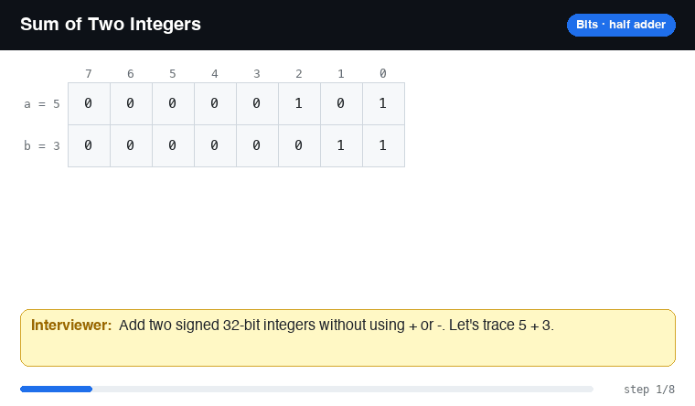

# Walkthrough: Sum of Two Integers

**Module:** [18 · Bit Manipulation](../README.md) · **Difficulty:** Medium · **Solution:** [`p09_sum_of_two_integers.go`](../p09_sum_of_two_integers.go)



## The problem in plain words

Add two numbers without using `+` or `-`. You may only use bit operations like XOR, AND and shifts. The numbers are signed 32-bit integers.

```
1 + 2         →  3
-2 + 3        →  1
MaxInt32 + 1  →  MinInt32   (wraps around, like hardware)
```

## Mock interview

**Interviewer:** Add two signed 32-bit integers without using the `+` or `-` operators.

**Candidate:** The type is `int32`, so if the sum overflows it should wrap around, like `MaxInt32 + 1 = MinInt32`?

**Interviewer:** Yes, match what the hardware does.

**Candidate:** `1 + 2 = 3` and `-2 + 3 = 1`. I'll trace `5 + 3` because it has carries that ripple. The answer should be 8.

**Candidate:** A brute force would count up from `a` one step at a time, `b` times. That's O(|b|), and it still needs an increment, which is addition.

**Interviewer:** How does hardware add?

**Candidate:** Column by column. For one column, the sum bit is `a XOR b`, and the carry is `a AND b`. So for whole words, `a ^ b` is the sum with every carry ignored, and `(a & b) << 1` is the carries, moved one column left. The real answer is the sum of those two. I repeat with `a = a ^ b` and `b = carry` until the carry is 0.

**Interviewer:** Why does that loop end?

**Candidate:** Each round, the lowest possible carry position moves at least one column left. With `int32`, after at most 32 rounds the carry shifts off the top and becomes 0. Go's signed integers are two's complement and overflow wraps, so that's well defined. Negative inputs work without any masking, unlike in Python, where integers have no fixed width.

**Candidate:** In code:

```go
for b != 0 {
    carry := (a & b) << 1
    a ^= b
    b = carry
}
return a
```

**Candidate:** Testing 5 + 3: `101 ^ 011 = 110` (6), carry `001 << 1 = 010` (2). Then `110 ^ 010 = 100` (4), carry `010 << 1 = 100` (4). Then `100 ^ 100 = 000`, carry `1000` (8). Then `0 ^ 8 = 8`, carry 0. The loop stops and returns 8.

**Interviewer:** Complexity?

**Candidate:** At most 32 rounds for `int32`, so **O(1) time** for a fixed width, and **O(1) space.**

**Interviewer:** How would you subtract?

**Candidate:** In two's complement, `-b` is `^b + 1`. So `a - b = GetSum(a, GetSum(^b, 1))`. That's `GetDifference` in the repo.

## What the animation shows

| Step | `a` | `b` | `a ^ b` | `(a & b) << 1` |
|---|---|---|---|---|
| 1 | Interviewer states the problem; trace 5 + 3 | | | |
| 2 | Brute force: count up `b` times, O(\|b\|) | | | |
| 3 | One column: XOR is the sum bit, AND is the carry | | | |
| 4 | 5 | 3 | 6 | 2 |
| 5 | 6 | 2 | 4 | 4 |
| 6 | 4 | 4 | 0 | 8 |
| 7 | 0 | 8 | 8 | 0 → stop |
| 8 | Answer 8; at most 32 rounds, O(1) space | | | |

The animation uses the `5 + 3` example from the doc comment's diagram. The first listed example, `1 + 2`, finishes in one round because there's no carry; the tracer still checks it, along with `-2 + 3` and `MaxInt32 + 1`. Bit rows show the low 8 bits of the `int32` values.

## Detailed explanation

The loop keeps one fact true: **`a + b` never changes.** At each step, `a + b = (a ^ b) + ((a & b) << 1)`, because XOR adds every column without carrying, and the AND-shift adds back exactly the carries that were dropped. So replacing `(a, b)` with `(a ^ b, (a & b) << 1)` keeps the sum. When `b` reaches 0, `a` is the sum.

The loop ends because the carry's lowest set bit moves left by at least one position every round. A carry can only come from a column where both `a` and `b` have a 1, and shifting it left puts it at least one column higher. After 32 rounds, any carry has been shifted out of an `int32`.

With negative numbers, carries can run all the way to the top. For `-2 + 3`, the carry walks up through every 1 bit of -2 and falls off after bit 31. That's why fixed width matters: in a language with unbounded integers, this loop would run forever, and you'd need to mask to 32 bits.

## Complexity

| Approach | Time | Space |
|---|---|---|
| Count up one at a time | O(\|b\|) | O(1) |
| XOR + carry loop (`GetSum`) | O(32) rounds at most | O(1) |
| Subtraction via two's complement (`GetDifference`) | O(32) rounds at most | O(1) |

## Common mistakes

- Forgetting the `<< 1` on the carry, so it lands in the wrong column.
- Overwriting `a` before computing the carry. Compute `carry` from the old `a` and `b` first.
- Porting this to Python without masking to 32 bits, which loops forever on negative inputs.

## Try it yourself

```sh
go test ./course/18-bit-manipulation/ -run TestGetSum -v
```
