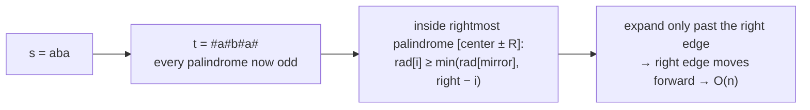

# 19 · Strings

## What you'll learn

- How Go represents strings (immutable bytes, UTF-8) and when to use `byte`, `rune`, `[]byte` or `strings.Builder`.
- Three linear-time pattern tools: the **KMP prefix function**, the **Z-function**, and **Rabin–Karp rolling hashes**.
- Palindrome techniques: two pointers, **expand around center**, and **Manacher's** O(n) algorithm.
- Careful parsing (atoi with overflow clamping) and in-place buffer rewriting.

## Recognize the pattern

| Signal | Tool |
|---|---|
| "Find pattern in text", "first occurrence", "count occurrences" | KMP / Z-function / Rabin–Karp |
| "Prefix that is also a suffix", "period of a string", "shortest repeating unit" | Prefix function (`pi[n-1]`) |
| "Repeated substring of length k", "compare many substrings" | Rolling hash (exact bit-packing when the alphabet is tiny) |
| "Palindrome" + substring | Expand around center; Manacher if n is large |
| "Palindrome" + at most k deletions | Two pointers, branch at the mismatch |
| "Smallest/longest window containing …" | Sliding window with counts (module 04) |
| "Parse", "convert", "compress" | Explicit state machine + read/write pointers |

## The idea

### Prefix function (KMP)

`pi[i]` = length of the longest proper prefix of `s[:i+1]` that is also its suffix (a *border*). When matching fails after `k` chars, the next candidate is the border of what we matched — `pi[k-1]` — so the text pointer never moves back.

```
needle = a b a b c       text: a b a b a b c
pi     = 0 0 1 2 0             a b a b ✗(a≠c) -> k = pi[3] = 2, keep text pointer
                                   a b a b c   ✓ match at index 2
```

### Z-function

`z[i]` = length of the longest common prefix of `s` and `s[i:]`. Search for `p` in `t` by computing `Z(p + sep + t)`; every `z[i] == len(p)` is a match.

### Rolling hash

```
h(s[l:r]) = prefix[r] − prefix[l]·base^(r−l)   (mod p)
slide:  drop s[l]·base^(k−1), multiply by base, add s[r]
```

Equal strings always hash equally; unequal ones rarely collide — so verify a hit (or use an exact encoding such as 2 bits per DNA letter).

### Manacher



## Go template

```go
// KMP prefix function.
pi := make([]int, len(s))
for i := 1; i < len(s); i++ {
	k := pi[i-1]
	for k > 0 && s[i] != s[k] {
		k = pi[k-1]
	}
	if s[i] == s[k] {
		k++
	}
	pi[i] = k
}

// Build strings efficiently.
var sb strings.Builder
sb.Grow(n)
sb.WriteByte('x')
out := sb.String()
```

`stringalgos.go` provides `PrefixFunction`, `ZFunction` and a `RollingHash` type with O(1) substring hashes. (The package is named `stringalgos` so it never shadows the standard `strings` package.)

## Complexity

| Technique | Time | Space |
|---|---|---|
| Brute-force matching | O(n·m) | O(1) |
| KMP / Z-function | O(n + m) | O(m) / O(n + m) |
| Rabin–Karp | O(n + m) expected | O(n) with prefix hashes, O(1) sliding |
| Expand around center | O(n²) | O(1) |
| Manacher | O(n) | O(n) |
| Sliding window with counts | O(n) | O(alphabet) |

## Common pitfalls

- **byte vs rune.** `s[i]` is a byte; `for i, r := range s` yields *runes* and byte offsets (which jump by 1–4). `len("héllo") == 6`. These solutions assume ASCII; for Unicode, convert once with `rs := []rune(s)` and work on `rs`.
- **String concatenation in a loop** (`s += x`) is O(n²) because strings are immutable. Use `strings.Builder` or a `[]byte` and convert once at the end.
- **Substrings share memory.** `s[i:j]` is O(1) and doesn't copy; but holding a tiny substring of a huge string keeps the whole thing alive. Use `strings.Clone` if that matters.
- **`[]byte(s)` copies** (O(n)). Do it once, not per iteration.
- **Integer overflow in parsing.** Check `result > (limit − d) / 10` *before* `result*10 + d`. `|MinInt32|` is one larger than `MaxInt32`, so the negative branch has a different limit.
- **Rolling-hash arithmetic.** With unsigned types `a − b` wraps; add the modulus before subtracting. Keep the modulus below 2^32 so products fit in `uint64`, or use `math/bits.Mul64`.
- **Hash collisions are real.** Always confirm a hash match by comparing the actual substrings unless the encoding is exact.
- **Sentinels in Z-search** must not appear in either string; `"\x00"` is safe for text, not for arbitrary bytes (then use index arithmetic instead).
- **Empty inputs.** Decide what `strStr(s, "")`, `atoi("")` and `minWindow(s, "")` return, and test them.

## Problems

| # | Problem | Difficulty | Key idea |
|---|---|---|---|
| 01 | [Valid Palindrome II](p01_valid_palindrome_ii.go) | Easy | Two pointers; at the mismatch try skipping either side |
| 02 | [Find the Index of the First Occurrence](p02_find_first_occurrence.go) | Easy | Brute → KMP → Z-function → Rabin–Karp |
| 03 | [Reverse Words in a String](p03_reverse_words.go) | Medium | `strings.Fields`; or squeeze + reverse all + reverse each word |
| 04 | [String Compression](p04_string_compression.go) | Medium | Read/write pointers, in place |
| 05 | [String to Integer (atoi)](p05_string_to_integer.go) | Medium | State machine + overflow check before multiply |
| 06 | [Longest Palindromic Substring](p06_longest_palindromic_substring.go) | Medium | Expand around 2n−1 centers; Manacher for O(n) |
| 07 | [Repeated DNA Sequences](p07_repeated_dna_sequences.go) | Medium | 2-bit rolling encoding = collision-free hash |
| 08 | [Longest Happy Prefix](p08_longest_happy_prefix.go) | Hard | `pi[n-1]`; or prefix/suffix hashes in one pass |
| 09 | [Minimum Window Substring](p09_minimum_window_substring.go) | Hard | Sliding window with need-counts and a `missing` counter |

## Practice tip

Write the prefix function from memory until you can do it in under two minutes — it unlocks problems 02 and 08 and many more. Then hide a solution, re-solve, and run:

```bash
go test ./course/19-strings/ -run TestStrStr -v
```

## Next

→ [20 · Design Problems](../20-design-problems/README.md)
