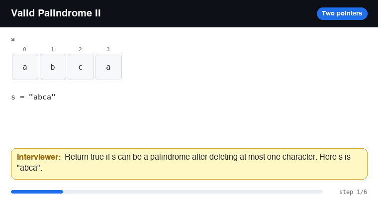

# Walkthrough: Valid Palindrome II

**Module:** [19 · Strings](../README.md) · **Difficulty:** Easy · **Solution:** [`p01_valid_palindrome_ii.go`](../p01_valid_palindrome_ii.go)



## The problem in plain words

You get a string. You may delete at most one character. Can the result read the same forwards and backwards?

```
"aba"  → true    (already a palindrome)
"abca" → true    (delete 'b' or 'c')
"abc"  → false
```

The animation uses `"abca"`, because `"aba"` never hits a mismatch.

## Mock interview

**Interviewer:** Return true if `s` can become a palindrome after deleting at most one character.

**Candidate:** A few questions first. Is "at most one" including zero deletions? Is the input ASCII? What about the empty string?

**Interviewer:** Yes, zero deletions is fine. Assume ASCII. An empty string or a single character is a palindrome.

**Candidate:** Let me check examples by hand. `"aba"` is already a palindrome. `"abca"` becomes `"aca"` if I delete `'b'`. `"abc"` fails: deleting any one letter leaves two different letters.

**Candidate:** The brute force tries deleting each index and re-checks the rest. That's n deletions, each with an O(n) check, so O(n²).

**Interviewer:** Can you avoid trying every deletion?

**Candidate:** Yes. I walk two pointers in from both ends. While the ends match, they can stay, so I move inward. At the first mismatch `s[l] != s[r]`, the character I delete must be one of those two. Everything outside them already matches. So I check two options: is `s[l+1..r]` a palindrome, or is `s[l..r-1]`? If either is, the answer is true.

**Interviewer:** Why only one branch? What if the next mismatch needs another choice?

**Candidate:** After the branch, I've used my one deletion. The helper `isPalindromeRange` just checks the rest with no more skips. So there's exactly one branch point, and the total work stays linear.

**Candidate:** In code: `ValidPalindromeII` runs `for l < r`. On a mismatch it returns `isPalindromeRange(s, l+1, r) || isPalindromeRange(s, l, r-1)`. If the loop finishes, it returns true.

**Candidate:** Testing `"abca"`: `s[0]` and `s[3]` are both `'a'`, so I move in. `s[1] = 'b'` and `s[2] = 'c'` differ. Skipping the left one leaves `s[2..2] = "c"`, a single character, so it's a palindrome. The answer is true.

**Interviewer:** Complexity?

**Candidate:** The main walk is O(n). The one extra check after the mismatch is at most O(n), and the `||` may run a second one. That's still **O(n) time and O(1) space**.

**Interviewer:** What if we allowed up to k deletions?

**Candidate:** The branching would grow to 2^k paths. For larger k, I'd switch to a DP on the longest palindromic subsequence: the answer is true if `n − LPS(s) ≤ k`. That's O(n²).

## What the animation shows

| Step | What happens |
|---|---|
| 1 | Interviewer states the problem on `"abca"` |
| 2 | Brute force: try every deletion, O(n²) |
| 3 | `s[0] = 'a'` equals `s[3] = 'a'`: move both pointers inward |
| 4 | `s[1] = 'b'` differs from `s[2] = 'c'`: one of them must go |
| 5 | Skip `s[1]`: `s[2..2] = "c"` is a palindrome → true |
| 6 | Answer `true`, O(n) time, O(1) space |

## Detailed explanation

The two pointers keep this invariant: *every character outside `[l, r]` already matches its mirror.* The loop only moves inward when `s[l] == s[r]`, so the invariant holds at every step.

When the first mismatch appears, any valid single deletion must remove `s[l]` or `s[r]`. If it removed some other character, `s[l]` and `s[r]` would still be mirrors of each other, and they differ. So two checks cover every case.

`isPalindromeRange` works on index ranges of the original string. It doesn't build substrings, so no memory is allocated.

Edge cases: an empty string and a single character skip the loop and return true. A string that is already a palindrome never mismatches and also returns true.

## Complexity

| Approach | Time | Space |
|---|---|---|
| Try every deletion (`ValidPalindromeIIBrute`) | O(n²) | O(n) for the new strings |
| Two pointers with one skip (`ValidPalindromeII`) | O(n) | O(1) |

## Common mistakes

- Checking only one side at the mismatch. `"cuppucu"`-style inputs need the other side.
- Allowing a second skip inside the helper, which turns "at most one" into "any number".
- Building `s[:i] + s[i+1:]` in the main solution. That allocates and makes it O(n²).

## Try it yourself

```sh
go test ./course/19-strings/ -run TestValidPalindromeII -v
```
