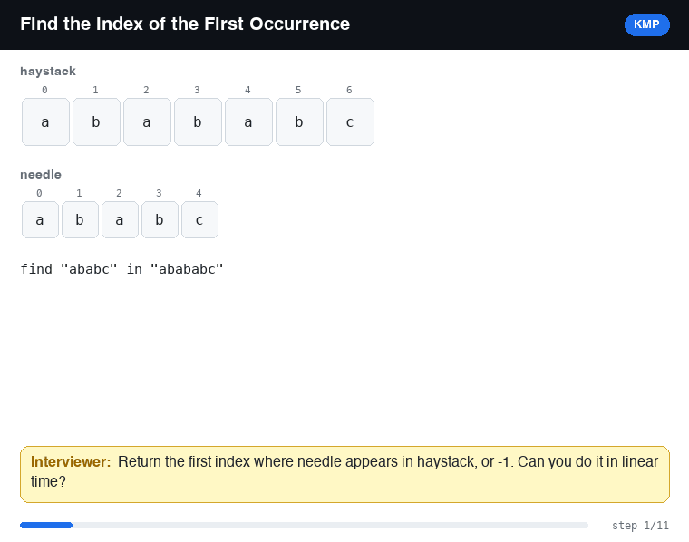

# Walkthrough: Find the Index of the First Occurrence

**Module:** [19 · Strings](../README.md) · **Difficulty:** Easy · **Solution:** [`p02_find_first_occurrence.go`](../p02_find_first_occurrence.go)



## The problem in plain words

Find where a short word (the needle) first appears inside a longer text (the haystack). Return its starting index, or -1 if it isn't there. An empty needle matches at index 0.

```
haystack "sadbutsad", needle "sad"   → 0
haystack "leetcode",  needle "leeto" → -1
```

The animation uses the module README's example, `"abababc"` and `"ababc"` → 2. The doc examples match immediately or never, so they don't show what makes KMP fast: the fallback after a partial match. The tracer still checks both doc examples.

## Mock interview

**Interviewer:** Return the first index where `needle` appears in `haystack`, or -1. Can you do it in linear time?

**Candidate:** Some questions. What do I return for an empty needle? Are the strings ASCII? Can the needle be longer than the haystack?

**Interviewer:** Empty needle returns 0. Treat the strings as bytes. If the needle is longer, return -1.

**Candidate:** For `"sadbutsad"` and `"sad"`, the answer is 0. For `"leetcode"` and `"leeto"`, it's -1. A harder case is `"abababc"` with `"ababc"`: a match starts at 0 and almost works, then fails at the fifth letter. The real match is at 2.

**Candidate:** The brute force tries every start and compares up to m characters. That's O(n·m). Its weakness is that after a mismatch it throws away everything it just matched and moves the start by one.

**Interviewer:** How do you avoid that?

**Candidate:** With KMP. I precompute the prefix function of the needle: `pi[j]` is the length of the longest proper prefix of `needle[:j+1]` that is also its suffix. For `"ababc"`, `pi = [0, 0, 1, 2, 0]`. `pi[3] = 2` says `"abab"` ends with `"ab"`, which is also how it starts.

**Candidate:** Then I scan the haystack once with a counter `k` of matched needle characters. If `haystack[i]` matches `needle[k]`, `k` goes up. If it doesn't, I set `k = pi[k-1]` and try again, without moving `i` back. The characters I just read already match the first `pi[k-1]` characters of the needle.

**Interviewer:** Why is that safe? Couldn't a match start somewhere you skipped?

**Candidate:** A match starting inside the failed attempt would need a prefix of the needle that is also a suffix of what I matched. `pi` gives the longest such border, and the inner loop tries shorter ones in turn. So no start is missed.

**Candidate:** In code, `StrStrKMP` calls `PrefixFunction(needle)`, then loops over `i`. Inside, a `for k > 0 && haystack[i] != needle[k]` loop falls back. When `k == m`, I return `i - m + 1`.

**Candidate:** On the example: `a, b, a, b` match, so `k = 4`. At `i = 4`, `'a'` doesn't match `needle[4] = 'c'`, so `k = pi[3] = 2`. Now `'a'` matches `needle[2]`, `k = 3`. Then `'b'` gives `k = 4` and `'c'` gives `k = 5`. The match ends at `i = 6`, so the answer is `6 − 5 + 1 = 2`.

**Interviewer:** Complexity?

**Candidate:** `k` rises by at most one per character, and every fallback lowers it, so the fallbacks total at most n. That's **O(n + m) time and O(m) space** for `pi`.

**Interviewer:** What would you use in production Go?

**Candidate:** `strings.Index`. It uses fast byte search and Rabin–Karp internally. The file also has `StrStrZ` with the Z-function and `StrStrRabinKarp` with a rolling hash that verifies each hit.

## What the animation shows

| Step | `i` | Needle index compared | Result |
|---|---|---|---|
| 1 | — | — | Interviewer states the problem |
| 2 | — | — | Brute force: O(n·m) |
| 3 | — | — | Build `pi = [0, 0, 1, 2, 0]` |
| 4 | 0 | 0 | `'a'` matches, `k = 1` |
| 5 | 1 | 1 | `'b'` matches, `k = 2` |
| 6 | 2 | 2 | `'a'` matches, `k = 3` |
| 7 | 3 | 3 | `'b'` matches, `k = 4` |
| 8 | 4 | 4 | `'a'` ≠ `'c'`: fall back `k = pi[3] = 2`, `i` stays |
| 9 | 4 | 2 | `'a'` matches, `k = 3` |
| 10 | 5 | 3 | `'b'` matches, `k = 4` |
| 11 | 6 | 4 | `'c'` matches, `k = 5` = m → answer 2 |

## Detailed explanation

The invariant is: *after reading `haystack[i]`, `k` is the length of the longest prefix of the needle that ends at `i`.* A match is found the first time `k` reaches `m`.

When `haystack[i]` doesn't extend the current match of length `k`, the next candidate is the longest border of `needle[:k]`, which is `pi[k-1]`. If that also fails, I take the border of the border. This is the same fallback chain `PrefixFunction` uses when it builds `pi`, because building `pi` is KMP run on the needle against itself.

The Z-function version builds `needle + "\x00" + haystack` and returns the first position whose `z` value is at least `m`. The separator stops a match from running across the boundary. The Rabin–Karp version compares the hash of each window to the needle's hash and checks the bytes on a hit, so a collision can't produce a wrong answer.

Edge cases: an empty needle returns 0 before any work. A needle longer than the haystack never reaches `k == m` and returns -1.

## Complexity

| Approach | Time | Space |
|---|---|---|
| Brute force (`StrStrBrute`) | O(n·m) | O(1) |
| KMP (`StrStrKMP`) | O(n + m) | O(m) |
| Z-function (`StrStrZ`) | O(n + m) | O(n + m) |
| Rabin–Karp (`StrStrRabinKarp`) | O(n + m) expected | O(n + m) |

## Common mistakes

- Moving `i` back after a mismatch. That brings back the O(n·m) worst case.
- Using `if` instead of `for` for the fallback. One fallback may not be enough.
- Returning `i - m` instead of `i - m + 1`.
- Trusting a Rabin–Karp hash match without comparing the bytes.

## Try it yourself

```sh
go test ./course/19-strings/ -run TestStrStr -v
```
