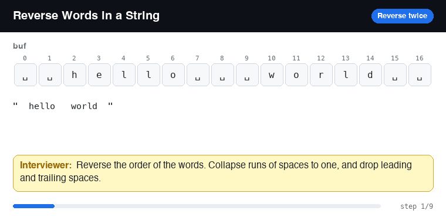

# Walkthrough: Reverse Words in a String

**Module:** [19 · Strings](../README.md) · **Difficulty:** Medium · **Solution:** [`p03_reverse_words.go`](../p03_reverse_words.go)



## The problem in plain words

Put the words of a sentence in reverse order. Words are separated by one or more spaces. The output has single spaces between words and no spaces at either end.

```
"the sky is blue"    → "blue is sky the"
"  hello   world  "  → "world hello"
```

The animation uses the second example, because its extra spaces make all three in-place phases do real work. The tracer also checks the first example.

## Mock interview

**Interviewer:** Reverse the order of the words. Collapse runs of spaces to one, and drop leading and trailing spaces.

**Candidate:** Is the separator only `' '`, or any whitespace? Can the input be all spaces? Should I return a new string, or can I change a buffer?

**Interviewer:** Assume `' '` for the in-place version. All spaces gives an empty string. Start with a string, then I'll ask about a buffer.

**Candidate:** For `"the sky is blue"` the answer is `"blue is sky the"`. For `"  hello   world  "` it's `"world hello"`. All spaces gives `""`.

**Candidate:** The simple Go answer is `ReverseWords`: `strings.Fields` splits on runs of whitespace and drops empty pieces. I reverse the slice and `strings.Join` it with single spaces. That's O(n) time and O(n) extra space.

**Interviewer:** Now do it in place on a `[]byte`, with O(1) extra space.

**Candidate:** I'll use "reverse twice". Reversing the whole buffer puts the words in the right order, but each word is backwards. Reversing each word again fixes the letters. Before that, I squeeze the spaces.

**Candidate:** Step one, the squeeze: a read pointer `r` skips spaces, and a write pointer `w` copies each word to the left, with one space before every word except the first. `w` never passes `r`, because I only write characters I've already read, and I drop at least as many spaces as I add. After the copy I keep `buf[:w]`.

**Candidate:** Step two reverses `buf[:w]`. Step three walks the words: for each one, it finds the next space and reverses the bytes between.

**Interviewer:** Walk me through the example.

**Candidate:** The squeeze copies `"hello"` from index 2 to 0, then a space and `"world"` from index 10 to 6. `buf[:11]` is `"hello world"`. Reversing all of it gives `"dlrow olleh"`. Reversing `buf[0:5]` gives `"world"`, and reversing `buf[6:11]` gives `"hello"`. The result is `"world hello"`.

**Interviewer:** Complexity?

**Candidate:** Each phase touches each byte a constant number of times, so it's **O(n) time and O(1) extra space**.

**Interviewer:** What changes for Unicode text?

**Candidate:** Reversing bytes would scramble multi-byte UTF-8 characters. The double reversal still works on runes, so I'd convert to `[]rune` once and run the same steps.

## What the animation shows

| Step | Phase | Buffer after the step |
|---|---|---|
| 1 | Problem | `"  hello   world  "` |
| 2 | Library version idea | (unchanged) |
| 3 | Squeeze: copy `"hello"` to index 0 | `hello` at 0–4, `w = 5` |
| 4 | Squeeze: copy `" world"` to index 5 | `hello world` at 0–10, `w = 11` |
| 5 | Cut to `buf[:11]` | `"hello world"` |
| 6 | Reverse all | `"dlrow olleh"` |
| 7 | Reverse word `buf[0:5]` | `"world olleh"` |
| 8 | Reverse word `buf[6:11]` | `"world hello"` |
| 9 | Answer and complexity | `"world hello"` |

## Detailed explanation

Why reversing twice works: if the sentence is `A B`, reversing the whole thing gives `rev(B) rev(A)`. Reversing each piece again gives `B A`. This holds for any number of words.

The squeeze is safe in place because of one invariant: *`w ≤ r` at all times.* At the start of each word after the first, at least one space has been skipped (so `r` has gained at least one on `w`), and the squeeze writes exactly one space. Inside a word, `w` and `r` move together.

`ReverseWordsInPlace` returns `buf[:w]` after the reversals, so the caller sees only the result. The bytes past `w` are leftovers and are not part of the answer.

Edge cases: an all-space buffer leaves `w = 0` and returns an empty slice. A single word is reversed twice and comes back unchanged.

## Complexity

| Approach | Time | Space |
|---|---|---|
| `strings.Fields` + reverse + `Join` (`ReverseWords`) | O(n) | O(n) |
| Squeeze + reverse all + reverse each word (`ReverseWordsInPlace`) | O(n) | O(1) extra |

## Common mistakes

- Forgetting to squeeze, so the output keeps double or trailing spaces.
- Writing the separating space before the first word, which leaves a leading space.
- Using `s += word` in a loop in the string version, which is O(n²).
- Reversing bytes of UTF-8 text that contains multi-byte characters.

## Try it yourself

```sh
go test ./course/19-strings/ -run TestReverseWords -v
```
