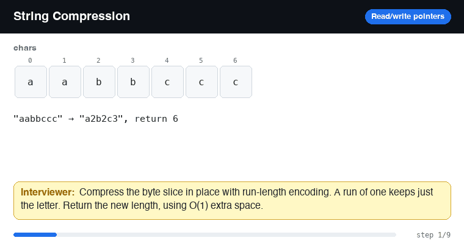

# Walkthrough: String Compression

**Module:** [19 · Strings](../README.md) · **Difficulty:** Medium · **Solution:** [`p04_string_compression.go`](../p04_string_compression.go)



## The problem in plain words

Shorten a byte slice by replacing each run of the same letter with the letter and the run length. A run of one keeps just the letter. Write the result over the input and return its length.

```
"aabbccc"       → 6, "a2b2c3"
"a"             → 1, "a"
"abbbbbbbbbbbb" → 4, "ab12"
```

## Mock interview

**Interviewer:** Compress `chars` in place with run-length encoding. Runs of one keep only the letter. Return the new length, using O(1) extra space.

**Candidate:** Questions: can a run be longer than 9, so the count needs several digits? Is the result always no longer than the input? What's in `chars` after the new length?

**Interviewer:** Yes, counts can have many digits. The result is never longer. Anything after the new length doesn't matter.

**Candidate:** For `"aabbccc"` I get `"a2b2c3"`, length 6. For `"a"`, just `"a"`. For `"ab"` followed by twelve `'b'`s, the `'a'` stays alone and the run becomes `"b12"`, so `"ab12"`.

**Candidate:** The easy version builds a new slice and appends a letter and its count for each run. That's `CompressNaive`. It's O(n) time, but O(n) extra memory.

**Interviewer:** How do you avoid the extra memory?

**Candidate:** Two pointers on the same slice. `read` finds each run. `write` is where the next output byte goes. For each run, I write the letter, then the count's digits if the run is longer than 1.

**Interviewer:** How do you know `write` won't overwrite bytes you haven't read yet?

**Candidate:** A run of length k turns into 1 + digits(k) bytes. For k = 1 that's 1 byte. For k ≥ 2, digits(k) ≤ k − 1, so the output is at most k bytes. Each run's output fits in the space the run used, so `write` never passes `read`.

**Candidate:** In `Compress`, the outer loop remembers `ch` and `start`, then an inner loop moves `read` to the end of the run. I write `ch`. If `run > 1`, I format it with `strconv.AppendInt` into a 20-byte array on the stack and copy the digits. That avoids any heap allocation.

**Candidate:** On `"aabbccc"`: the run of `'a'` is length 2, so I write `"a2"` and `write = 2`. The run of `'b'` gives `"b2"`, `write = 4`. The run of `'c'` is length 3, giving `"c3"`, `write = 6`, while `read = 7`. I return 6.

**Interviewer:** Complexity?

**Candidate:** Each byte is read once and written at most once: **O(n) time and O(1) extra space**.

**Interviewer:** What if a run could be longer than the int64 range?

**Candidate:** It can't, since a slice's length is an `int`. The 20-byte buffer is enough for any int64 in decimal.

## What the animation shows

| Step | What happens | `write` after |
|---|---|---|
| 1 | Interviewer states the problem | — |
| 2 | Naive: build a new slice, O(n) extra | — |
| 3 | `read` finds the run of `'a'`, length 2 | 0 |
| 4 | Write `'a'` and `"2"` | 2 |
| 5 | `read` finds the run of `'b'`, length 2 | 2 |
| 6 | Write `'b'` and `"2"` | 4 |
| 7 | `read` finds the run of `'c'`, length 3 | 4 |
| 8 | Write `'c'` and `"3"` | 6 |
| 9 | Answer 6, `chars[:6] = "a2b2c3"` | 6 |

## Detailed explanation

The invariant is: *`write ≤ start` whenever a new run begins.* At the start both are 0. Each run of length k moves `read` forward by k and `write` forward by at most k, so the gap never shrinks. That means every byte the writer touches has already been read.

The run length is computed as `read - start` after the inner loop. A run of length 1 writes only the letter, which is what the problem asks for.

The digits are produced with `strconv.AppendInt(digits[:0], int64(run), 10)`. `digits` is a fixed `[20]byte` array, so the slice it returns lives on the stack and nothing is allocated per run.

Edge cases: an empty slice returns 0. A single character returns 1. Long runs like twelve `'b'`s produce two digits.

## Complexity

| Approach | Time | Space |
|---|---|---|
| Build a new string (`CompressNaive`) | O(n) | O(n) |
| Read/write pointers in place (`Compress`) | O(n) | O(1) |

## Common mistakes

- Writing the count for runs of length 1, giving `"a1"` instead of `"a"`.
- Writing a count of 12 as one byte instead of the two digits `'1'`, `'2'`.
- Converting the count with `strconv.Itoa` inside the loop, which allocates a string per run.
- Returning the length of the input instead of `write`.

## Try it yourself

```sh
go test ./course/19-strings/ -run TestCompress -v
```
