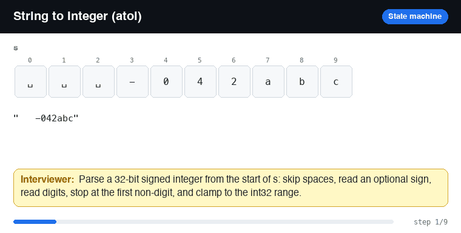

# Walkthrough: String to Integer (atoi)

**Module:** [19 · Strings](../README.md) · **Difficulty:** Medium · **Solution:** [`p05_string_to_integer.go`](../p05_string_to_integer.go)



## The problem in plain words

Read a whole number from the start of a string. Skip leading spaces, accept one optional sign, read digits until something else appears, and clamp the result to the 32-bit signed range.

```
"42"           → 42
"   -042abc"   → -42
"words 99"     → 0
"-91283472332" → -2147483648 (clamped)
```

The animation uses `"   -042abc"`, because it passes through every state: spaces, sign, digits with a leading zero, and a stop character.

## Mock interview

**Interviewer:** Parse a 32-bit signed integer from the start of `s`. Skip spaces, read an optional sign, read digits, stop at the first non-digit, and clamp to the int32 range.

**Candidate:** Questions: only `' '` counts as a space, not tabs? Is `"+-12"` valid? What if there are no digits?

**Interviewer:** Only `' '`. `"+-12"` gives 0, because after one sign a digit must follow. No digits gives 0.

**Candidate:** So `"42"` is 42. `"   -042abc"` is -42: the leading zero is fine and `"abc"` is ignored. `"words 99"` is 0 because it starts with a letter. `"-91283472332"` is below the int32 range, so it clamps to -2147483648.

**Candidate:** The simple approach cuts out the digit run and calls `strconv.ParseInt`. But a hundred-digit input overflows even int64. I'd rather check for overflow myself while I read.

**Interviewer:** How do you check without overflowing during the check?

**Candidate:** I keep the magnitude as a positive number. Before `result*10 + d`, I test `result > (limit - d) / 10`. That's the same inequality rearranged, and it only uses numbers no bigger than `limit`. If it's true, I set `result = limit` and stop.

**Candidate:** The limit depends on the sign. For `'+'` it's 2147483647. For `'-'` it's 2147483648, because `|MinInt32|` is one more than `MaxInt32`.

**Candidate:** In `MyAtoi` I skip spaces with a loop, then read one sign. Then a `for` loop runs while `s[i]` is a digit, doing the check and the update. At the end I apply the sign and convert to `int32`.

**Candidate:** On `"   -042abc"`: skip three spaces to `i = 3`. Read `'-'`, so `negative = true` and `limit = 2147483648`. Digit 0: `0 > 214748364`? No, `result = 0`. Digit 4: no, `result = 4`. Digit 2: no, `result = 42`. `'a'` stops the loop. The answer is -42.

**Interviewer:** Complexity?

**Candidate:** One pass, a few variables: **O(n) time and O(1) space**.

**Interviewer:** Why does the code use int64 at all, if the check prevents overflow?

**Candidate:** Only so that `limit` can hold 2147483648 for the negative case. The check keeps `result` at or below that, so it never needs more than 32 bits of magnitude.

## What the animation shows

| Step | State | What happens |
|---|---|---|
| 1 | — | Interviewer states the problem |
| 2 | — | Naive: parse with strconv, overflow risk |
| 3 | Spaces | Skip 3 spaces, `i = 3` |
| 4 | Sign | `'-'` → `negative = true`, `limit = 2147483648` |
| 5 | Digits | `0`: check passes, `result = 0` |
| 6 | Digits | `4`: check passes, `result = 4` |
| 7 | Digits | `2`: check passes, `result = 42` |
| 8 | Stop | `'a'` is not a digit |
| 9 | Done | Answer -42, O(n) time, O(1) space |

## Detailed explanation

The parser is a small state machine: spaces, then sign, then digits. Each state runs at most once and only moves forward, so there's no backtracking.

The overflow check rests on this rearrangement. For non-negative integers, `result*10 + d > limit` is the same as `result > (limit - d) / 10` with integer division. Every value in the right-hand form is at most `limit`, so computing it can't overflow.

The invariant in the digit loop is: *`result ≤ limit` after every step.* When the check fires, `result` is set to `limit` and the loop breaks. That gives the clamp: 2147483647 for positive input, and -2147483648 for negative input.

Edge cases: an empty string, or only spaces, returns 0. A sign with no digits returns 0. Leading zeros add nothing to `result`.

## Complexity

| Approach | Time | Space |
|---|---|---|
| State machine with pre-multiply overflow check (`MyAtoi`) | O(n) | O(1) |

## Common mistakes

- Checking overflow after `result*10 + d`, when the value has already wrapped.
- Using `MaxInt32` as the limit for negative numbers, so -2147483648 can't be parsed.
- Accepting a second sign, or a sign after spaces that follow digits.
- Skipping all whitespace instead of only `' '`.

## Try it yourself

```sh
go test ./course/19-strings/ -run TestMyAtoi -v
```
