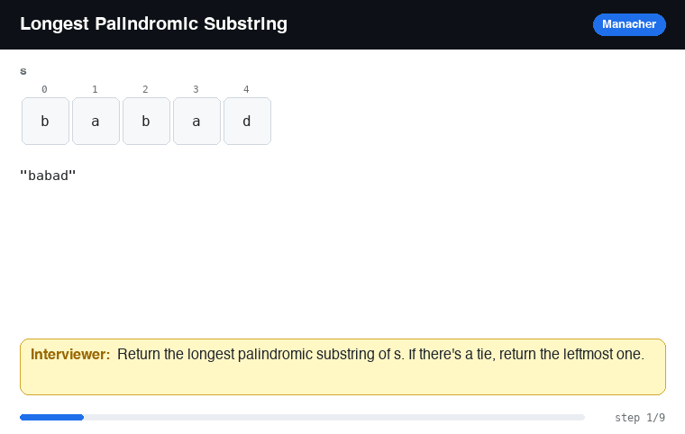

# Walkthrough: Longest Palindromic Substring

**Module:** [19 · Strings](../README.md) · **Difficulty:** Medium · **Solution:** [`p06_longest_palindromic_substring.go`](../p06_longest_palindromic_substring.go)



## The problem in plain words

Find the longest stretch of a string that reads the same forwards and backwards. If two are equally long, return the one that starts first.

```
"babad" → "bab"   ("aba" is as long but starts later)
"cbbd"  → "bb"
```

## Mock interview

**Interviewer:** Return the longest palindromic substring of `s`. On a tie, return the leftmost.

**Candidate:** Questions: is the input ASCII? What's the maximum length? What do I return for an empty string?

**Interviewer:** ASCII, up to 10⁵ characters, and an empty string returns `""`.

**Candidate:** For `"babad"`, both `"bab"` and `"aba"` have length 3, so I return `"bab"`. For `"cbbd"`, the answer `"bb"` has even length, so I must handle centres between letters too.

**Candidate:** The brute force checks every substring, longest first: O(n²) substrings, each checked in O(n), so O(n³). A better approach is expanding around centres. There are 2n − 1 of them, each letter and each gap, and each expansion is O(n). That's O(n²) time with O(1) space. That's `LongestPalindromeExpand`.

**Interviewer:** With n up to 10⁵, O(n²) is slow. Can you do better?

**Candidate:** Manacher's algorithm is O(n). First, I imagine a `#` between every letter and at both ends: `"babad"` becomes `"#b#a#b#a#d#"`. Now every palindrome has odd length and one centre. A radius `rad[i]` in this string equals the palindrome's length in `s`.

**Candidate:** The key idea is mirroring. I track the palindrome that reaches furthest right, with its `center` and `right` edge. For a position `i` inside it, the mirror `2·center − i` has already been computed. Inside the big palindrome, `i` looks the same as its mirror, so `rad[i]` is at least `min(rad[mirror], right − i)`. I start from that and only expand past the right edge.

**Interviewer:** Why is that linear?

**Candidate:** Every successful expansion step pushes `right` one further. `right` only moves forward and stops at the end, so all the expansion work adds up to O(n).

**Candidate:** In code, `LongestPalindromeManacher` never builds the new string. Position `i` is a `#` when `i` is even and `s[i/2]` when it's odd. A `match` helper compares positions. When `i + r > right`, I move `center` and `right`. I update `best` only on a strictly larger radius, so the leftmost answer wins ties.

**Candidate:** On `"babad"`: at `i = 1`, `'b'` expands to radius 1. At `i = 3`, `'a'` expands to radius 3: that's `"bab"`, and `right` becomes 6. At `i = 5`, the mirror is 1, so I start at radius `min(1, 6 − 5) = 1` and expand to 3: `"aba"`. It ties, so `best` stays at 3. At `i = 7`, I start at `min(3, 8 − 7) = 1` and can't expand. At `i = 9`, `'d'` has radius 1. The answer is `"bab"`.

**Interviewer:** Complexity?

**Candidate:** **O(n) time and O(n) space** for `rad`. In an interview I'd write expand-around-centre first, then mention Manacher if they want linear time.

## What the animation shows

The `#` positions with radius 0 and no reuse are skipped to keep the GIF short.

| Step | `i` | Start radius | Final radius | Palindrome |
|---|---|---|---|---|
| 1 | — | — | — | Interviewer states the problem |
| 2 | — | — | — | Brute force O(n³), expand O(n²) |
| 3 | — | — | — | Insert `#` separators (virtually) |
| 4 | 1 | 0 | 1 | `"b"` |
| 5 | 3 | 0 | 3 | `"bab"`, `right` moves to 6 |
| 6 | 5 | 1 (mirror 1) | 3 | `"aba"` (tie, not taken) |
| 7 | 7 | 1 (mirror 3, capped by `right`) | 1 | `"a"` |
| 8 | 9 | 0 | 1 | `"d"` |
| 9 | best = 3 | — | 3 | Answer `"bab"` |

## Detailed explanation

The separators remove the odd/even split. Positions that are symmetric about a centre have the same parity, so two `#`s always match and a `#` never meets a letter. That's why the `match` helper only compares real characters when `i` is odd.

The invariant is: *`t[center − rad[center] .. right]` is a palindrome, and `right` is the furthest right edge seen.* For any `i < right`, the mirror `j = 2·center − i` sits inside the same palindrome. The first `min(rad[j], right − i)` steps around `i` are copies of the steps around `j`, so they're known to match. Anything past `right` is unknown, so the code expands from there.

To map back to `s`, a radius `r` at position `i` covers `t[i − r .. i + r]`. That starts at index `(i − r) / 2` in `s` and has length `r`.

Edge cases: an empty string returns `""` before any work. A single character gives radius 1 at `i = 1`.

## Complexity

| Approach | Time | Space |
|---|---|---|
| Every substring (`LongestPalindromeBrute`) | O(n³) | O(1) |
| Expand around 2n − 1 centres (`LongestPalindromeExpand`) | O(n²) | O(1) |
| Manacher (`LongestPalindromeManacher`) | O(n) | O(n) |

## Common mistakes

- Expanding only around letters, which misses even-length answers like `"bb"`.
- Starting the radius at `rad[mirror]` without capping it at `right − i`.
- Updating `best` on `>=`, which returns the rightmost tie instead of the leftmost.
- Building the `#`-padded string with `+=` in a loop, which is O(n²).

## Try it yourself

```sh
go test ./course/19-strings/ -run TestLongestPalindrome -v
```
