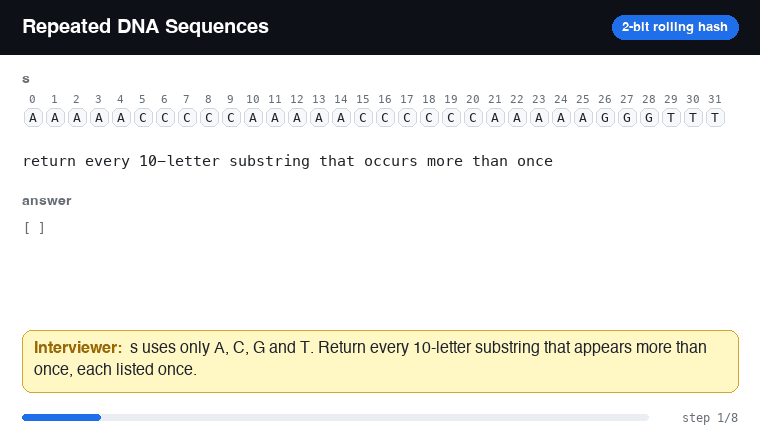

# Walkthrough: Repeated DNA Sequences

**Module:** [19 · Strings](../README.md) · **Difficulty:** Medium · **Solution:** [`p07_repeated_dna_sequences.go`](../p07_repeated_dna_sequences.go)



## The problem in plain words

A DNA string uses only the letters A, C, G and T. Find every 10-letter piece that appears more than once. Pieces may overlap. List each one once, sorted.

```
"AAAAACCCCCAAAAACCCCCCAAAAAGGGTTT" → ["AAAAACCCCC" "CCCCCAAAAA"]
"AAAAAAAAAAAAA"                    → ["AAAAAAAAAA"]
```

## Mock interview

**Interviewer:** `s` contains only A, C, G and T. Return every 10-letter substring that occurs more than once, each listed once.

**Candidate:** Questions: can occurrences overlap? Does the output order matter? How long can `s` be?

**Interviewer:** Overlaps count. Return them sorted. `s` can be up to 10⁵ letters.

**Candidate:** In `"AAAAAAAAAAAAA"`, which has 13 A's, the window `"AAAAAAAAAA"` appears at starts 0, 1, 2 and 3, so it's listed once. In the long example, `"AAAAACCCCC"` appears at 0 and 10, and `"CCCCCAAAAA"` at 5 and 16. A string shorter than 10 has no windows, so the answer is empty.

**Candidate:** The direct approach counts every window in a `map[string]int` and records a window when its count hits 2. That's `FindRepeatedDNASubstrings`. It's linear in the number of windows, but every key is a 10-byte string that the map has to hash and compare.

**Interviewer:** Can you make it cheaper?

**Candidate:** The alphabet has four letters, so each letter fits in 2 bits: A = 00, C = 01, G = 10, T = 11. Ten letters fit in 20 bits. So each window becomes a single integer, and two different windows always get different integers. It's a perfect hash with no collisions to verify.

**Candidate:** Sliding the window is O(1): `window = (window<<2 | code(c)) & mask`, where `mask = 1<<20 − 1`. The shift makes room for the new letter, and the mask removes the oldest letter's 2 bits.

**Candidate:** In `FindRepeatedDNA`, `code` is a `[256]uint32` lookup table. I loop over every index, update `window`, and `continue` until 10 letters have been read. Then I do `count[window]++`. When a count becomes exactly 2, I append `s[i-9 : i+1]`. At the end I sort the result.

**Candidate:** On the long example: at `i = 9` the window `"AAAAACCCCC"` is `00 00 00 00 00 01 01 01 01 01`, which is 341. At `i = 10`, the shift drops the first A and adds the next A. At `i = 19` window 341 appears again, so I add `"AAAAACCCCC"`. At `i = 25` window 349184 (`"CCCCCAAAAA"`) reaches count 2. Sorted, the answer is `["AAAAACCCCC" "CCCCCAAAAA"]`.

**Interviewer:** Complexity?

**Candidate:** Each step is a shift, an OR, a mask and a map update: **O(n) time**. The map holds at most one entry per window, so **O(n) space**, and never more than 4¹⁰ keys.

**Interviewer:** What if the alphabet had 26 letters and windows were longer?

**Candidate:** The exact encoding would no longer fit in 64 bits. I'd use a Rabin–Karp rolling hash modulo a large prime and compare the actual substrings when hashes match, to rule out collisions.

## What the animation shows

Most window steps are skipped. The GIF shows the first full window, one slide, and the two windows that repeat.

| Step | `i` | What happens |
|---|---|---|
| 1 | — | Interviewer states the problem |
| 2 | — | Map of substrings: hashing 10-byte keys |
| 3 | — | 2-bit encoding and the slide formula |
| 4 | 9 | First full window, `"AAAAACCCCC"` = 341, count 1 |
| 5 | 10 | Slide: shift, OR in `'A'`, mask out the old `'A'` |
| 6 | 19 | Window 341 again → add `"AAAAACCCCC"` |
| 7 | 25 | Window 349184 again → add `"CCCCCAAAAA"` |
| 8 | — | Sorted answer, O(n) time and space |

## Detailed explanation

The invariant is: *after processing `s[i]` with `i ≥ 9`, `window` is the 20-bit code of `s[i−9 .. i]`.* Shifting left by 2 moves every letter one slot older. The OR puts the new letter in the lowest 2 bits. The mask clears bits 20 and up, which held the letter that just left the window.

Because the encoding is a one-to-one mapping from 10-letter strings to 20-bit numbers, equal counts mean equal strings. There's no need to compare substrings after a hit.

Appending only when the count becomes exactly 2 lists each repeated window once, no matter how many more times it appears. The substring `s[i-dnaLen+1 : i+1]` shares memory with `s`, so it doesn't copy.

Edge cases: strings shorter than 10 never fill the window and return an empty result. Overlapping repeats, like the run of A's, are counted correctly because every start position is a separate window.

## Complexity

| Approach | Time | Space |
|---|---|---|
| Map of substrings (`FindRepeatedDNASubstrings`) | O(n·L), L = 10 for hashing keys | O(n·L) |
| 2-bit rolling encoding (`FindRepeatedDNA`) | O(n) | O(n) |

## Common mistakes

- Forgetting the mask, so old letters stay in the high bits and every window looks new.
- Counting before the window is full, which adds partial windows to the map.
- Appending on every count ≥ 2, which lists the same sequence several times.
- Using a modular hash without verifying hits, when the exact 2-bit encoding needs no check.

## Try it yourself

```sh
go test ./course/19-strings/ -run TestFindRepeatedDNA -v
```
