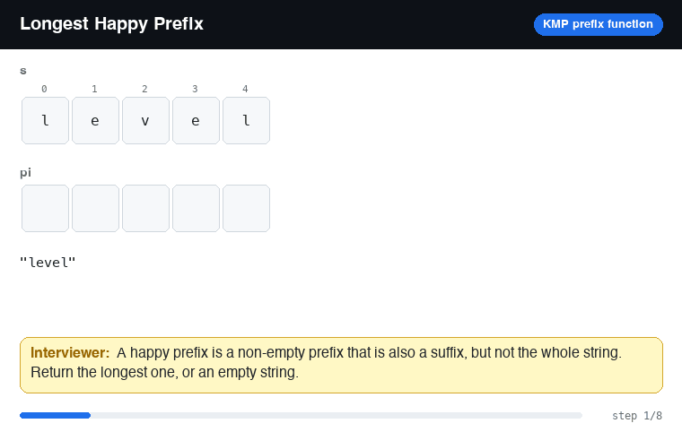

# Walkthrough: Longest Happy Prefix

**Module:** [19 · Strings](../README.md) · **Difficulty:** Hard · **Solution:** [`p08_longest_happy_prefix.go`](../p08_longest_happy_prefix.go)



## The problem in plain words

Find the longest beginning of a string that is also its ending, without using the whole string. The beginning and ending may overlap.

```
"level"  → "l"
"ababab" → "abab"   (prefix and suffix overlap)
"abc"    → ""
```

## Mock interview

**Interviewer:** A happy prefix is a non-empty prefix that's also a suffix, excluding the string itself. Return the longest one, or `""`.

**Candidate:** Questions: may the prefix and suffix overlap? What's the maximum length? What do I return for a one-letter string?

**Interviewer:** They may overlap. Up to 10⁵ characters. A single letter returns `""`, since the whole string doesn't count.

**Candidate:** For `"level"`, `"l"` is both the first and last letter, while `"le"` and `"ev"` differ. So the answer is `"l"`. For `"ababab"`, `"abab"` starts at 0 and also at 2, so it's the answer even though the two copies overlap. `"abc"` has none.

**Candidate:** The brute force tries each length `k` from `n − 1` down to 1 and compares `s[:k]` with `s[n−k:]`. Each comparison is O(k), so the worst case is O(n²).

**Interviewer:** Can you do it in linear time?

**Candidate:** This is the KMP prefix function. `pi[i]` is the length of the longest proper prefix of `s[:i+1]` that is also its suffix, a "border". The answer is the longest border of the whole string, which is `pi[n−1]`. So I return `s[:pi[n−1]]`.

**Candidate:** To build `pi`, for each `i` I take the previous border `k = pi[i−1]` and try to extend it by one: if `s[i] == s[k]`, then `pi[i] = k + 1`. If not, I fall back to `k = pi[k−1]`, the next shorter border, and try again. If `k` reaches 0 and still no match, `pi[i] = 0`.

**Candidate:** In code, `LongestPrefixKMP` returns `""` for an empty string, calls `PrefixFunction(s)` and slices `s[:pi[len(s)-1]]`.

**Candidate:** On `"level"`: `pi[0] = 0`. At `i = 1`, `'e'` ≠ `'l'`, so `pi[1] = 0`. The same happens for `'v'` and the second `'e'`. At `i = 4`, `'l'` equals `s[0]`, so `pi[4] = 1`. The answer is `s[:1] = "l"`.

**Interviewer:** Why is the fallback loop still linear overall?

**Candidate:** `k` goes up by at most one per character, and each fallback lowers it by at least one. It can't go below zero, so the total number of fallbacks is at most n. That gives **O(n) time and O(n) space** for `pi`.

**Interviewer:** Is there an O(1) space option?

**Candidate:** Yes, `LongestPrefixHash`. It grows a prefix hash and a suffix hash together and remembers the longest `k` where they agree. It compares the actual strings on a hash match, so a collision can't cause a wrong answer.

## What the animation shows

| Step | `i` | Compare | `pi[i]` |
|---|---|---|---|
| 1 | — | Interviewer states the problem | — |
| 2 | — | Brute force O(n²) | — |
| 3 | 0 | One character has no proper border | 0 |
| 4 | 1 | `'e'` vs `s[0] = 'l'`, no match | 0 |
| 5 | 2 | `'v'` vs `'l'`, no match | 0 |
| 6 | 3 | `'e'` vs `'l'`, no match | 0 |
| 7 | 4 | `'l'` vs `'l'`, match | 1 |
| 8 | — | Answer `s[:pi[4]] = "l"` | — |

## Detailed explanation

Every border of `s[:i+1]`, apart from the empty one, is a border of `s[:i]` extended by one character. So to find `pi[i]`, it's enough to try the borders of `s[:i]` from longest to shortest and take the first one whose next character equals `s[i]`.

The borders of `s[:i]` are `pi[i−1]`, then `pi[pi[i−1] − 1]`, and so on. That's why the fallback is `k = pi[k−1]`. The invariant is: *at each step of the inner loop, `s[:k]` is a border of `s[:i]`.*

The hash version uses the same idea from a different angle. `pre` is the hash of `s[:k]`, built by appending `s[k−1]`. `suf` is the hash of `s[n−k:]`, built by prepending `s[n−k]` with the next power of the base. When they match and the strings really are equal, `k` is a happy prefix length.

Edge cases: the empty string returns `""`. A one-letter string has `pi[0] = 0`, so it returns `""`.

## Complexity

| Approach | Time | Space |
|---|---|---|
| Compare every length (`LongestPrefixBrute`) | O(n²) | O(1) |
| Prefix function (`LongestPrefixKMP`) | O(n) | O(n) |
| Prefix and suffix hashes (`LongestPrefixHash`) | O(n) expected | O(1) |

## Common mistakes

- Returning the whole string when it equals itself. The prefix must be proper.
- Using `if` instead of `for` for the fallback, which misses shorter borders.
- Trusting the hash match without comparing the strings.
- Assuming the prefix and suffix can't overlap, which breaks `"ababab"`.

## Try it yourself

```sh
go test ./course/19-strings/ -run TestLongestPrefix -v
```
