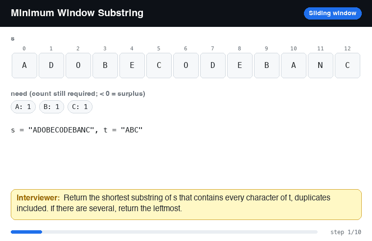

# Walkthrough: Minimum Window Substring

**Module:** [19 · Strings](../README.md) · **Difficulty:** Hard · **Solution:** [`p09_minimum_window_substring.go`](../p09_minimum_window_substring.go)



## The problem in plain words

Find the shortest stretch of `s` that contains every letter of `t`, including repeats. If there are several of the same length, return the first. If none exists, return `""`.

```
s = "ADOBECODEBANC", t = "ABC" → "BANC"
s = "a",             t = "aa"  → ""
```

## Mock interview

**Interviewer:** Given `s` and `t`, return the shortest substring of `s` that contains every character of `t`, counting duplicates.

**Candidate:** Questions: is it case-sensitive? Are the strings ASCII? What do I return if `t` is empty, or if there's no window?

**Interviewer:** Case-sensitive, ASCII bytes. Return `""` for an empty `t` or no window. On a tie, the leftmost.

**Candidate:** For `"ADOBECODEBANC"` and `"ABC"`, `"ADOBEC"` works with length 6, but `"BANC"` at the end has length 4. For `"a"` and `"aa"`, I need two `'a'`s and only have one, so the answer is `""`.

**Candidate:** The brute force tries each start and extends right until the window covers `t`. That's O(|s|²) with a count array. It redoes the same counting for every start.

**Interviewer:** How do you avoid that?

**Candidate:** A sliding window with two pointers that only move forward. I keep `need[c]`, how many more `c`'s the window still needs. It starts as the counts in `t`. Letters `t` doesn't have, or surplus copies, go negative. I also keep `missing`, the total number of characters still needed.

**Candidate:** Moving `right`: if `need[c] > 0`, this character was useful, so `missing--`. Either way `need[c]--`. When `missing` hits 0, the window is valid. I record it if it's the shortest so far, then shrink from the left: `need[s[left]]++`, and if that makes it positive, I just dropped a required character, so `missing++` and the shrinking stops.

**Interviewer:** Why a single `missing` counter instead of comparing count arrays?

**Candidate:** Comparing 256 counts on every step would be O(256) each time. `missing` changes by one exactly when a needed character enters or leaves, so the check is O(1).

**Candidate:** In code, `MinWindow` uses a `[256]int` for `need`. The outer `for right` loop grows the window, and an inner `for missing == 0` loop shrinks it. At the end, if no window was found, it returns `""`.

**Candidate:** On the example: `'A'` at 0 and `'B'` at 3 are needed. `'C'` at 5 completes `"ADOBEC"`, length 6. Dropping `'A'` breaks it. The second `'B'` at 9 is surplus. `'A'` at 10 completes the window again; I shrink past D, O, B and E, then dropping `'C'` breaks it. `'C'` at 12 completes it again; I shrink to `"EBANC"`, length 5, then `"BANC"`, length 4. Dropping `'B'` breaks it. The answer is `"BANC"`.

**Interviewer:** Complexity?

**Candidate:** `left` and `right` each move at most |s| times, plus O(|t|) to fill `need`: **O(|s| + |t|) time**. The array has 256 entries: **O(1) space**.

**Interviewer:** What would change for Unicode strings?

**Candidate:** I'd convert both to `[]rune` and use a `map[rune]int` for `need`. The logic stays the same.

## What the animation shows

Steps where nothing important changes are skipped.

| Step | Window | What happens |
|---|---|---|
| 1 | — | Interviewer states the problem |
| 2 | — | Brute force O(\|s\|²) |
| 3 | `[0..0]` | `'A'` needed, `missing = 2` |
| 4 | `[0..3]` | `'B'` needed, `missing = 1` |
| 5 | `[0..5]` | Valid `"ADOBEC"`, best = 6; drop `'A'` breaks it |
| 6 | `[1..9]` | Second `'B'` is surplus, `need['B'] = -1` |
| 7 | `[5..10]` | Valid after dropping D, O, B, E; drop `'C'` breaks it |
| 8 | `[8..12]` | Valid `"EBANC"`, best = 5; drop `'E'` |
| 9 | `[9..12]` | Valid `"BANC"`, best = 4; drop `'B'` breaks it |
| 10 | — | Answer `"BANC"` |

## Detailed explanation

The invariant is: *`missing` equals the number of characters of `t` (with repeats) not yet covered by `s[left..right]`.* A character only counts toward coverage while `need` for it is positive before the update. That is why surplus copies don't lower `missing`.

When `missing == 0`, the window is valid. Shrinking from the left is safe while the dropped character is surplus. The first drop that makes `need[c]` positive removes a required character, so every window starting further left was already tried, and every longer window from this `left` is worse than the one just recorded.

Recording only on a strictly shorter length keeps the leftmost answer on ties, because windows are found in left-to-right order.

Edge cases: an empty `t`, or `t` longer than `s`, returns `""` at the start. If no window is ever valid, `bestLen` stays at `len(s) + 1` and the function returns `""`.

## Complexity

| Approach | Time | Space |
|---|---|---|
| Every start, extend until valid (`MinWindowBrute`) | O(\|s\|² · alphabet) | O(1) |
| Sliding window with `need` and `missing` (`MinWindow`) | O(\|s\| + \|t\|) | O(1) |

## Common mistakes

- Decrementing `missing` for surplus characters, which declares a window valid too early.
- Checking validity by comparing two count arrays on every step.
- Recording the window after shrinking instead of before, which misses the current valid window.
- Forgetting the "no window" case and slicing with an invalid length.

## Try it yourself

```sh
go test ./course/19-strings/ -run TestMinWindow -v
```
