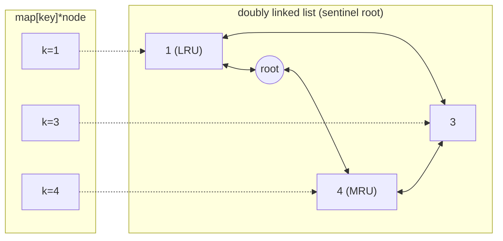

# 20 · Design Problems (OOD / coding-design rounds)

## What you'll learn

- How to turn a spec ("O(1) get and put, evict least recently used") into a **type with methods and invariants**.
- The handful of compositions behind almost every design question: **map + linked list**, **map + sorted slice + binary search**, **ring buffer of buckets**, **stack of aggregates**, **heap merge**, **explicit iterator stack**.
- Making a type **safe for concurrent use** in Go — and when `sync.RWMutex` is wrong.
- How these toy structures map to real systems (caches, rate limiters, feeds).

## Recognize the pattern

| Requirement | Composition |
|---|---|
| O(1) lookup **and** O(1) reorder/evict | `map[K]*node` + doubly linked list (LRU) |
| Evict by frequency, ties by recency | `map[K]*node` + `map[freq]*list` + `minFreq` (LFU) |
| "Value at time t", "as of snapshot s" | per-key sorted history + binary search for the floor |
| "Count in the last N seconds" | ring of N buckets `(timestamp, count)` |
| "O(1) min/max of a stack" | push the running aggregate with each element |
| "Top k most recent across many sources" | k-way merge with a heap |
| "Pause traversal and resume later" | iterator holding an explicit stack |
| "At most N per second with bursts" | token bucket with lazy refill |

## The idea

Interviewers grade design rounds on four things — work through them out loud, in order:

1. **API first.** Write the method signatures and a three-line usage example before any internals.
2. **Pick the composition** from the table above and state each operation's complexity.
3. **Name the invariant** ("the list is ordered most → least recent and holds exactly the map's nodes") and make every method restore it.
4. **Concurrency and edge cases.** Capacity 0, missing keys, duplicate timestamps, clock skew; then say how it behaves with many goroutines.

LRU, the canonical example:



```
Get(1):  unlink node 1, push it after root           ->  root ⇄ 1 ⇄ 4 ⇄ 3
Put(5):  full -> evict root.prev (3), delete map[3]  ->  root ⇄ 5 ⇄ 1 ⇄ 4
```

## Go template

```go
type Cache[K comparable, V any] struct {
	mu    sync.Mutex // Get mutates recency: NOT an RWMutex
	cap   int
	items map[K]*node[K, V]
	order *dlist[K, V]
}

func (c *Cache[K, V]) Get(k K) (V, bool) {
	c.mu.Lock()
	defer c.mu.Unlock()
	n, ok := c.items[k]
	if !ok {
		var zero V
		return zero, false
	}
	c.order.moveToFront(n)
	return n.val, true
}
```

`design.go` holds the generic sentinel-based doubly linked list (`pushFront`, `remove`, `back`, `moveToFront`) shared by the LRU and LFU caches.

## Complexity

| Design | Operations | Space |
|---|---|---|
| Min/Max stack | O(1); `PopMax` O(n) | O(n) |
| Hit counter | `Hit` O(1), `GetHits` O(window) | O(window) |
| Peeking / nested iterator | O(1) amortized per element | O(depth) |
| Time map | `Set` O(1) amortized, `Get` O(log n) | O(entries) |
| Snapshot array | `Set`/`Snap` O(1), `Get` O(log s) | O(length + sets) |
| LRU cache | O(1) | O(capacity) |
| LFU cache | O(1) | O(capacity) |
| Token bucket | O(1) | O(1) |
| Twitter feed | post O(1), feed O(f + k log f) | O(users + tweets + follows) |

## Common pitfalls

- **RWMutex on a cache.** LRU/LFU `Get` reorders the list — a write. Taking `RLock` there is a data race that `go test -race` will catch. Reserve `RWMutex` for truly read-only paths (`TimeMap.Get`, `Twitter.GetNewsFeed`).
- **Copying a type that contains a mutex.** Methods need pointer receivers, and constructors should return `*T`. `go vet` flags copies of `sync.Mutex`.
- **Maps aren't safe for concurrent writes.** The runtime may crash with "concurrent map writes" — it's not just a wrong answer.
- **Forgetting the key in the node.** On eviction you have the node, not the key; without `node.key` you can't delete the map entry.
- **LFU `minFreq` bookkeeping.** It only moves up by one on a touch, and resets to 1 on every insert. Never search for it.
- **Lists without sentinels** need special cases for head, tail and single-element lists — the most common source of nil-pointer panics in live coding.
- **Real clocks in tests.** Inject `now func() time.Time` and drive a fake clock; `time.Sleep` makes tests slow and flaky.
- **Check-then-act races.** "Read tokens, then subtract" must be one critical section; two atomics in a row still race.
- **Returning internal slices.** Returning a slice that aliases internal state lets callers mutate your data; return a copy when it matters.
- **`append` invalidates pointers into a slice.** In the nested iterator a pointer to the top frame is not reused after pushing a new frame.

## Problems

| # | Problem | Difficulty | Key idea |
|---|---|---|---|
| 01 | [Min Stack / Max Stack](p01_min_max_stack.go) | Medium | Store `(value, running min/max)` per frame |
| 02 | [Design Hit Counter](p02_hit_counter.go) | Medium | 300-bucket ring keyed by `ts % 300` · concurrency-safe |
| 03 | [Peeking Iterator & Flatten Nested List](p03_iterators.go) | Medium | One-element lookahead; explicit frame stack; `iter.Seq` |
| 04 | [Time-Based Key-Value Store](p04_time_map.go) | Medium | Per-key sorted history + floor binary search · RWMutex |
| 05 | [Snapshot Array](p05_snapshot_array.go) | Medium | Copy-on-write history per index |
| 06 | [LRU Cache](p06_lru_cache.go) | Medium | Map + doubly linked list · concurrency-safe |
| 07 | [LFU Cache](p07_lfu_cache.go) | Hard | Freq → LRU list, plus `minFreq` · concurrency-safe |
| 08 | [Rate Limiter (token bucket)](p08_rate_limiter.go) | Medium | Lazy refill, injected clock, one mutex · `-race` test |
| 09 | [Design Twitter](p09_design_twitter.go) | Medium | Heap merge of per-user timelines (fan-out on read) |

### Related production patterns

These interview structures are the small cores of real system-design building blocks in the companion repo [system-design-patterns-go](https://github.com/neerajsinghi/system-design-patterns-go):

| Here | There |
|---|---|
| LRU / LFU cache | [patterns/data/cache-aside](https://github.com/neerajsinghi/system-design-patterns-go/tree/main/patterns/data/cache-aside) — the cache in front of a database, with TTLs and invalidation |
| Token bucket | [patterns/reliability/rate-limiter-token-bucket](https://github.com/neerajsinghi/system-design-patterns-go/tree/main/patterns/reliability/rate-limiter-token-bucket) — per-client buckets and HTTP middleware |
| Twitter feed | [patterns/architecture/fan-out-feed](https://github.com/neerajsinghi/system-design-patterns-go/tree/main/patterns/architecture/fan-out-feed) — fan-out on write vs read at scale |

## Practice tip

Design rounds reward talking while you type. Hide the solution, set a 25-minute timer, and say the API, the composition, the invariant and the concurrency story *before* writing code. Then check yourself, always with the race detector:

```bash
go test -race ./course/20-design-problems/ -run TestLRU -v
```

## Next

**Finish** → back to the [course overview](../../README.md). Good luck in your interviews!
