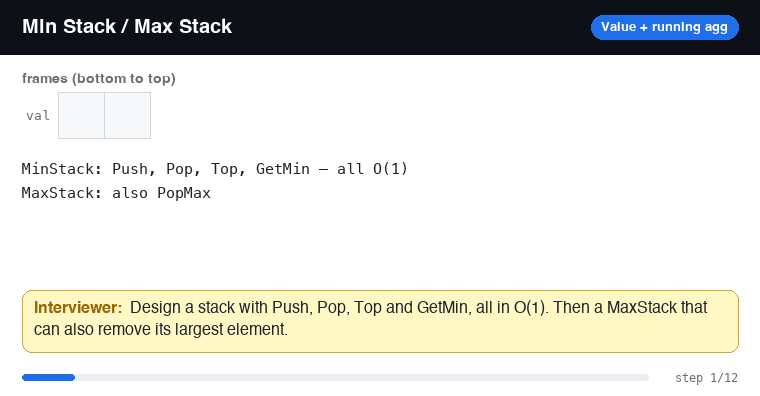

# Walkthrough: Min Stack / Max Stack

**Module:** [20 · Design Problems](../README.md) · **Difficulty:** Medium · **Solution:** [`p01_min_max_stack.go`](../p01_min_max_stack.go)



## The problem in plain words

Build a stack that can also tell you its smallest element at any moment, in constant time. Then build a stack that can tell you its largest element and also remove it.

```
MinStack: push -2, push 0, push -3, min → -3, pop, top → 0, min → -2
MaxStack: push 5, push 1, push 5, popMax → 5 (the top one), top → 1
```

## Mock interview

**Interviewer:** Design a `MinStack` with `Push`, `Pop`, `Top` and `GetMin`, all O(1). Then a `MaxStack` with `Push`, `Pop`, `Top`, `PeekMax` and `PopMax`.

**Candidate:** Questions: what should `Pop` or `GetMin` do on an empty stack? Should it be generic? Is it used from many goroutines? For `PopMax` with duplicates, which copy goes?

**Interviewer:** Return `ok = false` on empty. Generic over ordered types is nice. Single goroutine. `PopMax` removes the top-most maximum.

**Candidate:** For the MinStack example: after pushing -2, 0, -3 the minimum is -3. After popping -3, the top is 0 and the minimum goes back to -2. That second part is the tricky bit.

**Candidate:** The naive way scans the whole stack on `GetMin`, which is O(n). Keeping one `min` variable is O(1) for reads, but after popping the minimum I no longer know the previous one.

**Interviewer:** So how do you get the old minimum back?

**Candidate:** I store it with each element. Every frame holds `(val, agg)`, where `agg` is the minimum of this value and everything below it. `Push(v)` sets `agg = min(v, top.agg)`. `GetMin` reads `top.agg`. `Pop` removes the frame, and the frame below already holds the minimum of what remains. Nothing needs recomputing.

**Candidate:** In Go, `frame[T cmp.Ordered]` holds `val` and `agg`. `MinStack[T]` and `MaxStack[T]` each wrap a `[]frame[T]`. The only difference is `min` versus `max` in `Push`.

**Candidate:** Testing: `Push(-2)` stores `(-2, -2)`. `Push(0)` stores `(0, -2)`. `Push(-3)` stores `(-3, -3)`. `GetMin` reads -3. `Pop` removes `(-3, -3)`. `Top` is 0, and `GetMin` reads -2 from `(0, -2)`.

**Interviewer:** And `PopMax`?

**Candidate:** `PeekMax` is O(1) with the same trick. `PopMax` has to remove an element that may be buried. I pop into a buffer until I reach the max, drop it, then push the buffer back in the original order so every frame's `agg` is recomputed. That's O(n). In the example, after pushing 5, 1, 5, the max is the top 5, so the buffer is empty. Afterward `Top` is 1.

**Interviewer:** Complexity?

**Candidate:** **O(1) for every operation except `PopMax`, which is O(n)**. Space is O(n). If `PopMax` must be faster, a doubly linked list plus a max-heap with lazy deletion gives O(log n).

**Interviewer:** What if many goroutines share it?

**Candidate:** It isn't safe as written. I'd wrap it in a struct with a `sync.Mutex` and lock in every method. `Push` and `Pop` both write, so a read-write lock wouldn't help much.

## What the animation shows

| Step | Call | Stack after (val, min or max) | Result |
|---|---|---|---|
| 1 | — | empty | Interviewer states the problem |
| 2 | — | empty | Naive: scan, or a single variable that's lost on Pop |
| 3 | `Push(-2)` | (-2,-2) | — |
| 4 | `Push(0)` | (-2,-2) (0,-2) | — |
| 5 | `Push(-3)` | (-2,-2) (0,-2) (-3,-3) | — |
| 6 | `GetMin()` | same | -3 |
| 7 | `Pop()` | (-2,-2) (0,-2) | -3 |
| 8 | `Top()` | same | 0 |
| 9 | `GetMin()` | same | -2 |
| 10 | MaxStack `Push(5) Push(1) Push(5)` | (5,5) (1,5) (5,5) | `PeekMax` 5 |
| 11 | `PopMax()` | (5,5) (1,5) | 5, empty buffer |
| 12 | `Top()` | same | 1 |

## Detailed explanation

The invariant is: *for every frame at depth i, `agg` is the minimum (or maximum) of all values at depths 0 through i.* `Push` keeps it, since the new frame combines its value with the frame below. `Pop` keeps it, because removing the top doesn't change any frame below.

This is a general pattern: store a running aggregate with each stack frame. It works for any aggregate that can be computed from "this value" and "the aggregate below", such as min, max, or a running sum.

`PopMax` is harder because it removes from the middle. Popping into a buffer and pushing back rebuilds the aggregates for the frames above the removed one. The loop compares `top == target` and stops at the first match from the top, so the top-most maximum is the one removed.

Edge cases: every method returns `ok = false` on an empty stack. Duplicate minimums are fine, because each frame has its own copy of the aggregate.

## Complexity

| Operation | Time | Space |
|---|---|---|
| `MinStack.Push`, `Pop`, `Top`, `GetMin` | O(1) | O(n) total |
| `MaxStack.Push`, `Pop`, `Top`, `PeekMax` | O(1) | O(n) total |
| `MaxStack.PopMax` | O(n) | O(n) buffer |

## Common mistakes

- Keeping one `min` variable and losing the previous minimum after a pop.
- Using a second "min stack" that only pushes on a strict new minimum, which breaks with duplicates.
- Pushing the buffer back in the wrong order in `PopMax`.
- Removing the bottom-most maximum instead of the top-most.

## Try it yourself

```sh
go test ./course/20-design-problems/ -run TestMinStack -v
```
