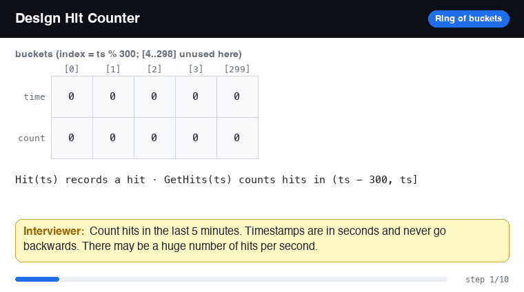

# Walkthrough: Design Hit Counter

**Module:** [20 · Design Problems](../README.md) · **Difficulty:** Medium · **Solution:** [`p02_hit_counter.go`](../p02_hit_counter.go)



## The problem in plain words

Count how many hits arrived in the last 5 minutes (300 seconds). Timestamps are whole seconds and never go backwards. Many hits can share a second.

```
Hit(1) Hit(2) Hit(3) GetHits(4) → 3
Hit(300) GetHits(300)           → 4
GetHits(301)                    → 3   (the hit at 1 has expired)
```

## Mock interview

**Interviewer:** `Hit(ts)` records a hit at second `ts`. `GetHits(ts)` returns the hits in the last 300 seconds. Timestamps never decrease.

**Candidate:** Questions: is the window `(ts − 300, ts]`, so a hit exactly 300 seconds old is out? Can several hits share a timestamp? How many hits per second? Is it called from many goroutines?

**Interviewer:** Yes to the window. Hits can share a second, and there may be millions per second. Assume concurrent callers.

**Candidate:** In the example, `GetHits(4)` sees hits at 1, 2 and 3. At 300 the hit at 1 is 299 seconds old, still in, so 4. At 301 it's exactly 300 seconds old, so it's out: 3.

**Candidate:** The usual first answer is a queue of hit timestamps. `GetHits` pops anything older than 300 seconds and returns the queue length. That works, but memory grows with traffic: a million hits per second means a million queue entries.

**Interviewer:** How do you bound the memory?

**Candidate:** I only need a count per second, and only for 300 seconds. So I keep a ring of 300 buckets. Bucket `ts % 300` stores the timestamp it holds and its count. On `Hit`, if the bucket's stored time isn't `ts`, it belongs to an old second, so I reset it to `ts` with count 0. Then I add one.

**Candidate:** `GetHits(ts)` loops over all 300 buckets and adds the count of every bucket whose time is within the window: `ts − times[i] < 300`. Stale buckets are skipped on read, so they never need cleaning.

**Candidate:** In code, `HitCounter` has `times` and `counts` as `[300]int` arrays and a `sync.Mutex`. Both methods lock it.

**Candidate:** Walking the example: `Hit(1)`, `Hit(2)`, `Hit(3)` fill buckets 1, 2 and 3. `GetHits(4)` sums them: 3. `Hit(300)` maps to bucket 0. Its stored time was 0, so it's reset to 300, count 1. `GetHits(300)` counts buckets 0 to 3: 4. `GetHits(301)` skips bucket 1, because `301 − 1 = 300` is not less than 300: 3.

**Interviewer:** Complexity?

**Candidate:** **`Hit` is O(1). `GetHits` is O(300)**, a constant. **Space is O(300)**, no matter how much traffic arrives.

**Interviewer:** How would this behave with many goroutines?

**Candidate:** The mutex makes each call atomic, so it's correct. Under very heavy load the single lock becomes a bottleneck. I could shard the counter into several copies by goroutine or CPU and sum them in `GetHits`, or use atomic adds per bucket with care around the reset.

## What the animation shows

The grid shows only buckets 0–3 and 299. The others stay unused in this example.

| Step | Call | Buckets touched | Result |
|---|---|---|---|
| 1 | — | — | Interviewer states the problem |
| 2 | — | — | Naive queue: memory grows with traffic |
| 3 | `Hit(1)` | bucket 1 reset to time 1, count 1 | — |
| 4 | `Hit(2)` | bucket 2 → time 2, count 1 | — |
| 5 | `Hit(3)` | bucket 3 → time 3, count 1 | — |
| 6 | `GetHits(4)` | buckets 1–3 in window | 3 |
| 7 | `Hit(300)` | bucket 0 reset to time 300, count 1 | — |
| 8 | `GetHits(300)` | buckets 0–3 in window | 4 |
| 9 | `GetHits(301)` | bucket 1 expired | 3 |
| 10 | — | — | Complexity and locking |

## Detailed explanation

The invariant is: *bucket `i` holds the count for the most recent second `t` with `t % 300 == i` that received a hit.* Two seconds that share a bucket are at least 300 seconds apart, so by the time a newer second writes there, the older one has left the window. Resetting on write is therefore safe.

Reads don't trust a bucket just because its count is non-zero. They check `ts − times[i] < 300`. That handles buckets that went stale without being overwritten, like bucket 1 at time 301.

Hits that share a second just increment the same bucket, so a burst of a million hits costs a million O(1) increments and no extra memory.

Edge cases: buckets start with time 0 and count 0, so they add nothing. The window boundary is exclusive at the old end: a hit exactly 300 seconds old is not counted.

## Complexity

| Operation | Time | Space |
|---|---|---|
| `HitCounter.Hit` | O(1) | O(300) total |
| `HitCounter.GetHits` | O(300) | — |

## Common mistakes

- Using `<=` in the window check, which counts hits that are exactly 300 seconds old.
- Not storing the timestamp per bucket, so an old count gets added to a new second.
- Clearing old buckets on read, which turns a read into a write and needs a stronger lock.
- Storing every hit in a queue when traffic can be huge.

## Try it yourself

```sh
go test ./course/20-design-problems/ -run TestHitCounter -v
```
