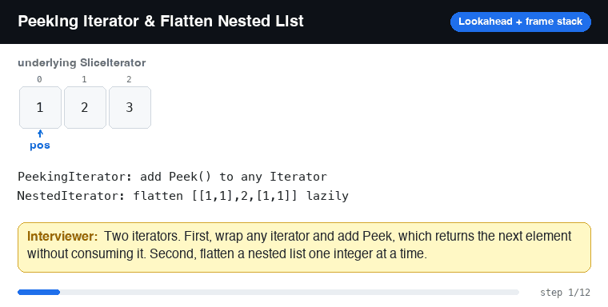

# Walkthrough: Peeking Iterator & Flatten Nested List

**Module:** [20 · Design Problems](../README.md) · **Difficulty:** Medium · **Solution:** [`p03_iterators.go`](../p03_iterators.go)



## The problem in plain words

Two small iterator designs. First, wrap any iterator so you can look at the next element without taking it. Second, walk a list that contains numbers and other lists, and hand out the numbers one at a time in order.

```
peek over [1,2,3]: Next 1, Peek 2, Next 2, Next 3, HasNext false
flatten [[1,1],2,[1,1]] → 1 1 2 1 1
```

## Mock interview

**Interviewer:** Build a `PeekingIterator` that wraps any `Iterator` and adds `Peek`. Then build a `NestedIterator` that flattens a nested list lazily.

**Candidate:** Questions: does `Peek` on an empty iterator need to be safe? Can nested lists be empty, or deeply nested? Is the iterator shared across goroutines?

**Interviewer:** You may assume `Peek` and `Next` are only called when `HasNext` is true. Lists can be empty and nested to any depth. One consumer.

**Candidate:** For `[1,2,3]`: `Next` gives 1, `Peek` gives 2 without consuming it, then `Next` gives 2 and `Next` gives 3. For `[[1,1],2,[1,1]]` the output is 1, 1, 2, 1, 1. A case like `[[],[[]]]` should give nothing at all.

**Candidate:** The lazy answer is to copy everything into a slice up front. That costs O(n) memory, and it doesn't work for streams or when the caller stops early.

**Interviewer:** How do you add `Peek` without reading everything?

**Candidate:** I cache one element. `Peek` calls the underlying `Next` once, stores the value in `cached` and sets `peeked = true`. `Next` returns the cache if it's full, and otherwise calls through. `HasNext` is `peeked || it.HasNext()`.

**Candidate:** On `[1,2,3]`: `Next` passes through and returns 1. `Peek` reads 2 into the cache. `Next` returns 2 from the cache and clears it. `Next` returns 3 from the underlying iterator. `HasNext` is false.

**Interviewer:** And the nested list?

**Candidate:** Recursion would be natural, but an iterator has to pause between elements. So I keep an explicit stack of frames, each a `(list, pos)` pair. `HasNext` does the work: it looks at the top frame. If the frame is finished, it pops it. If the current item is a list, it moves `pos` past it in the parent and pushes a frame for the sub-list. If the current item is an integer, it stops and returns true. `Next` calls `HasNext`, returns the integer and moves `pos`.

**Interviewer:** Why put the work in `HasNext` rather than `Next`?

**Candidate:** Empty lists mean "is there another number?" can only be answered by walking forward. Putting that walk in `HasNext` makes it idempotent: calling it twice doesn't skip anything. `Next` stays trivial.

**Candidate:** On `[[1,1],2,[1,1]]`: `HasNext` sees `[1,1]`, steps past it and pushes a frame. `Next` returns 1, then 1. Then the inner frame is done and gets popped, and the parent points at 2. `Next` returns 2. `HasNext` meets the last `[1,1]` and pushes a frame. `Next` returns 1, then 1. Then both frames are popped, and `HasNext` is false.

**Interviewer:** Complexity?

**Candidate:** Each list is pushed once and popped once, so it's **O(1) amortized per element and O(depth) space** for the stack.

**Interviewer:** How would you write this in modern Go?

**Candidate:** With a Go 1.23 `iter.Seq[int]`. The `All` function is a short recursive walk that calls `yield`. If `yield` returns false, because the caller broke out of the `range` loop, the walk stops.

## What the animation shows

| Step | Call | State after the call | Result |
|---|---|---|---|
| 1 | — | — | Interviewer states both problems |
| 2 | — | — | Naive: copy everything up front |
| 3 | `Next()` | `pos = 1`, no cache | 1 |
| 4 | `Peek()` | `pos = 2`, cached 2 | 2 |
| 5 | `Next()` | cache cleared | 2 |
| 6 | `Next()`, `HasNext()` | `pos = 3` | 3, false |
| 7 | `Next()` | frames: parent pos 1, inner `[1,1]` pos 1 | 1 |
| 8 | `Next()` | inner frame popped; parent at 2 | 1 |
| 9 | `Next()` | parent pos 3, new inner frame pos 0 | 2 |
| 10 | `Next()` | inner frame pos 1 | 1 |
| 11 | `Next()` | stack empty | 1 |
| 12 | `HasNext()` | stack empty | false; output 1 1 2 1 1 |

## Detailed explanation

`PeekingIterator` keeps this invariant: *if `peeked` is true, `cached` is the next element and the underlying iterator has moved past it.* `Next` clears the cache and also sets `cached` to the zero value, so the iterator doesn't keep a reference the caller now owns.

`NestedIterator` keeps this invariant after `HasNext` returns true: *the top frame's `pos` points at an integer.* `HasNext` steps `pos` past a sub-list before pushing the child frame, so when the child is finished and popped, the parent is already at the next item. The code takes care not to use the `top` pointer after `append`, because `append` may move the stack's backing array.

Each list is entered once and left once. Empty lists are pushed and popped immediately, which is why `HasNext` is a loop.

Edge cases: an empty top-level list returns false at once. Deep nesting costs one frame per level. Calling `HasNext` many times in a row doesn't change the output.

## Complexity

| Operation | Time | Space |
|---|---|---|
| `PeekingIterator.Peek`, `Next`, `HasNext` | O(1) | O(1) |
| `NestedIterator.HasNext`, `Next` | O(1) amortized | O(depth) |
| `All` (range-over-func) | O(1) amortized per element | O(depth) call stack |

## Common mistakes

- Having `Peek` call the underlying `Next` every time, which skips elements.
- Letting `HasNext` return true when the next item is an empty list.
- Doing the descent in `Next`, so `HasNext` can't answer correctly for empty lists.
- Holding a pointer into the stack slice across an `append`.

## Try it yourself

```sh
go test ./course/20-design-problems/ -run 'TestPeekingIterator|TestNestedIterator' -v
```
