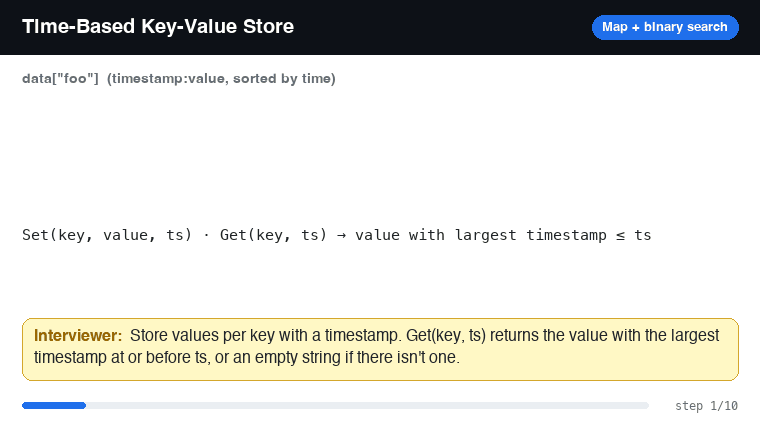

# Walkthrough: Time-Based Key-Value Store

**Module:** [20 · Design Problems](../README.md) · **Difficulty:** Medium · **Solution:** [`p04_time_map.go`](../p04_time_map.go)



## The problem in plain words

A key-value store that remembers history. Each write has a timestamp. A read asks "what was the value at time t?" and gets the latest value written at or before t.

```
Set("foo","bar",1)
Get("foo",1) → "bar"   Get("foo",3) → "bar"
Set("foo","bar2",4)
Get("foo",4) → "bar2"  Get("foo",5) → "bar2"  Get("foo",0) → ""
```

## Mock interview

**Interviewer:** Implement `Set(key, value, ts)` and `Get(key, ts)`. `Get` returns the value with the largest timestamp ≤ `ts`, or `""`.

**Candidate:** Questions: do timestamps arrive in increasing order? What if the same key and timestamp are set twice? Will many goroutines read and write?

**Interviewer:** Usually increasing, but handle out-of-order writes. A repeated timestamp overwrites. Yes, it's concurrent, and reads are much more common.

**Candidate:** In the example, `Get` at 3 returns `"bar"` because 1 is the latest timestamp ≤ 3. `Get` at 0 returns `""`, since nothing was written that early.

**Candidate:** The simple design keeps a list of versions per key and scans it on every `Get`. That's O(n) per read.

**Interviewer:** Can you do better?

**Candidate:** If I keep each key's versions sorted by timestamp, `Get` is a "floor" binary search: find the last timestamp ≤ `ts`. When timestamps arrive in order, `Set` is just an append, which keeps the slice sorted for free.

**Candidate:** The store is a `map[string][]timedValue`. `Get` uses `slices.BinarySearchFunc` to find `i`, the first index with timestamp ≥ `ts`. If it's an exact hit, I return `entries[i]`. If `i == 0`, everything is newer, so I return `""`. Otherwise the answer is `entries[i−1]`.

**Candidate:** `Set` has a fast path: if the slice is empty or the last timestamp is smaller, append. Otherwise it binary searches. An exact hit overwrites the value, and a miss inserts at that position with `slices.Insert`.

**Candidate:** On the example: `Set` at 1 appends `(1, bar)`. `Get` at 1 is an exact hit at `i = 0`. `Get` at 3 gives `i = 1`, past the end, so I return entry 0, `"bar"`. `Set` at 4 appends `(4, bar2)`. `Get` at 4 is an exact hit. `Get` at 5 gives `i = 2`, so entry 1, `"bar2"`. `Get` at 0 gives `i = 0`, so `""`.

**Interviewer:** Complexity?

**Candidate:** **`Get` is O(log n)** per key. **`Set` is O(1) amortized** for in-order writes, and O(n) for an out-of-order insert because the slice shifts. Space is O(total entries).

**Interviewer:** How would this behave with many goroutines?

**Candidate:** `Get` only reads, so I use a `sync.RWMutex`. Many `Get` calls hold the read lock together, and `Set` takes the write lock. If writes became heavy, I'd shard the map by key hash so different keys don't share a lock.

## What the animation shows

| Step | Call | Search index `i` | Result |
|---|---|---|---|
| 1 | — | — | Interviewer states the problem |
| 2 | — | — | Naive: scan every version |
| 3 | `Set("foo","bar",1)` | — | appends `(1, bar)` |
| 4 | `Get("foo",1)` | 0, exact | `"bar"` |
| 5 | `Get("foo",3)` | 1 → use entry 0 | `"bar"` |
| 6 | `Set("foo","bar2",4)` | — | appends `(4, bar2)` |
| 7 | `Get("foo",4)` | 1, exact | `"bar2"` |
| 8 | `Get("foo",5)` | 2 → use entry 1 | `"bar2"` |
| 9 | `Get("foo",0)` | 0 → nothing older | `""` |
| 10 | — | — | Complexity and locking |

## Detailed explanation

The invariant is: *each key's slice is sorted by timestamp with no duplicates.* The fast-path append keeps it because the new timestamp is larger than the last one. The slow path keeps it because the binary search returns exactly the position where the new timestamp belongs, and an exact match overwrites instead of inserting.

`slices.BinarySearchFunc` returns the first index whose timestamp is ≥ the target and whether it matched exactly. The floor is then either that entry (exact match) or the one before it. When the index is 0 and there's no exact match, every stored timestamp is newer than the query.

Edge cases: a key that was never set has a nil slice, so the search returns `i = 0` and `Get` returns `""`. Setting the same timestamp twice keeps only the latest value.

## Complexity

| Operation | Time | Space |
|---|---|---|
| `TimeMap.Set` (in order) | O(1) amortized | O(1) per entry |
| `TimeMap.Set` (out of order) | O(log n + n) | — |
| `TimeMap.Get` | O(log n) | — |

## Common mistakes

- Returning the first timestamp ≥ `ts` instead of the last one ≤ `ts`.
- Forgetting the `i == 0` case and reading `entries[-1]`.
- Appending out-of-order writes, which breaks the sorted order and the binary search.
- Using a plain `Mutex`, which makes concurrent reads wait for each other.

## Try it yourself

```sh
go test ./course/20-design-problems/ -run TestTimeMap -v
```
