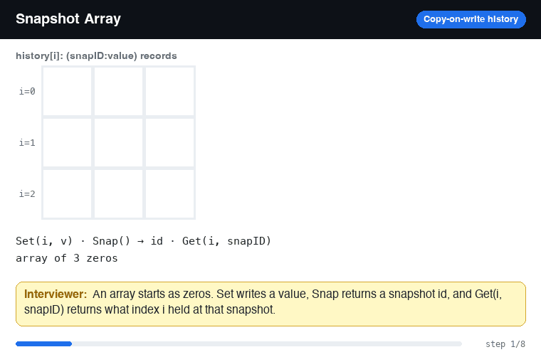

# Walkthrough: Snapshot Array

**Module:** [20 · Design Problems](../README.md) · **Difficulty:** Medium · **Solution:** [`p05_snapshot_array.go`](../p05_snapshot_array.go)



## The problem in plain words

An array starts full of zeros. You can write values, take a snapshot, and later ask what an index held when a given snapshot was taken.

```
a := NewSnapshotArray(3)
a.Set(0, 5); a.Snap() → 0
a.Set(0, 6); a.Get(0, 0) → 5
```

## Mock interview

**Interviewer:** Implement `Set(i, val)`, `Snap()` which returns a snapshot id, and `Get(i, snapID)` which returns index i's value at that snapshot.

**Candidate:** Questions: how large can the array be, and how many snapshots? Are most indices untouched between snapshots? Is it concurrent?

**Interviewer:** Up to 50,000 elements and 50,000 snapshots. Most snapshots change few indices. Single goroutine.

**Candidate:** In the example, index 0 is 5 when snapshot 0 is taken. Setting it to 6 afterwards must not change what snapshot 0 says. Indices never set read as 0 in every snapshot.

**Candidate:** The simple design copies the whole array on every `Snap`. That's O(length) time and memory per snapshot. With 50,000 of each, that's 2.5 billion values, even if only one index changed.

**Interviewer:** How do you avoid the copies?

**Candidate:** Copy-on-write per index. Each index keeps its own history: a list of `(snapID, value)` records, sorted by `snapID`. `Set` only touches that one index. `Snap` just increments a counter. Only indices that change pay for storage.

**Candidate:** `Set(i, val)` checks the last record of index i. If it was written in the current version, it overwrites it. Otherwise it appends `(snapID, val)`. `Snap` returns `snapID` and then increments it. `Get(i, snapID)` binary searches index i's history for the first record with `snap > snapID`. The record before it is the answer. If there isn't one, the value is 0.

**Candidate:** In Go, `history` is a `[][]snapRecord` and `Get` uses `sort.Search`.

**Candidate:** On the example: `NewSnapshotArray(3)` makes three empty histories, `snapID = 0`. `Set(0, 5)` appends `(0, 5)`. `Snap()` returns 0, and `snapID` becomes 1. `Set(0, 6)` appends `(1, 6)`. `Get(0, 0)` finds the first record with snap > 0 at `j = 1`, so it returns record 0's value: 5.

**Interviewer:** Complexity?

**Candidate:** **`Set` and `Snap` are O(1). `Get` is O(log s)** for s records at that index. **Space is O(length + number of sets)**.

**Interviewer:** What if it were shared by many goroutines?

**Candidate:** `Set` and `Snap` write, so I'd add a `sync.RWMutex`, with `Get` under the read lock. `Snap` could also be an atomic counter, but `Set` reads `snapID` to tag the record, so `Set` and `Snap` must not interleave. One lock is simpler and correct.

## What the animation shows

| Step | Call | History of index 0 | Result |
|---|---|---|---|
| 1 | — | — | Interviewer states the problem |
| 2 | — | — | Naive: copy the array on every Snap |
| 3 | `NewSnapshotArray(3)` | empty | `snapID = 0` |
| 4 | `Set(0, 5)` | (0,5) | — |
| 5 | `Snap()` | (0,5) | 0, `snapID = 1` |
| 6 | `Set(0, 6)` | (0,5) (1,6) | — |
| 7 | `Get(0, 0)` | search finds `j = 1` | 5 |
| 8 | — | — | Complexity |

## Detailed explanation

The invariant is: *each index's history is sorted by `snap`, with at most one record per snapshot version.* `Set` keeps it: in the current version it either overwrites its own record or appends one with the current `snapID`, which is never smaller than the last record's.

`snapID` is the version being written right now. `Snap` freezes it by moving on to the next number. Records tagged with a frozen version are never changed again.

`Get` needs the last record with `snap ≤ snapID`. `sort.Search` finds the first record with `snap > snapID`, so the answer is the one just before it. If that position is 0, the index was never set before that snapshot, so it still holds its initial 0.

Edge cases: many `Set` calls between two snapshots keep only the last value. Querying a snapshot after the index's last change returns the latest record.

## Complexity

| Operation | Time | Space |
|---|---|---|
| `SnapshotArray.Set` | O(1) amortized | O(1) per new record |
| `SnapshotArray.Snap` | O(1) | — |
| `SnapshotArray.Get` | O(log s) | — |

## Common mistakes

- Copying the whole array in `Snap`.
- Appending a new record on every `Set`, even within the same version, which bloats history.
- Searching for `snap ≥ snapID` instead of `snap > snapID`, an off-by-one.
- Returning the record at the found position instead of the one before it.

## Try it yourself

```sh
go test ./course/20-design-problems/ -run TestSnapshotArray -v
```
