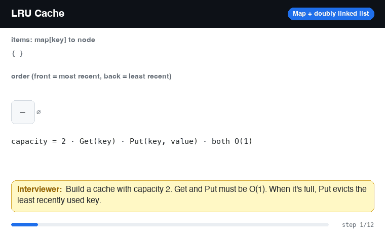

# Walkthrough: LRU Cache

**Module:** [20 · Design Problems](../README.md) · **Difficulty:** Medium · **Solution:** [`p06_lru_cache.go`](../p06_lru_cache.go)



## The problem in plain words

A cache with room for a fixed number of keys. Reading or writing a key marks it as recently used. When the cache is full and a new key arrives, throw out the key that hasn't been used for the longest time.

```
capacity 2:
Put(1,1) Put(2,2) Get(1) → 1     order now: 1, 2 (most → least recent)
Put(3,3)                         evicts 2
Get(2) → miss   Put(4,4) evicts 1   Get(1) → miss   Get(3) → 3   Get(4) → 4
```

## Mock interview

**Interviewer:** Design an LRU cache with a fixed capacity. `Get` and `Put` must both run in O(1).

**Candidate:** Questions: does `Put` on an existing key count as a use? What should `Get` return on a miss? What about capacity 0? Will many goroutines use it?

**Interviewer:** Yes, updating counts as a use. Return `(zero, false)` on a miss. Capacity 0 stores nothing. Yes, it's concurrent.

**Candidate:** In the example, after `Get(1)`, key 1 is more recent than 2. So `Put(3,3)` evicts 2. Later `Put(4,4)` evicts 1, because 3 was used more recently.

**Candidate:** A map alone gives O(1) lookup, but finding the least recent key means scanning timestamps: O(n). A slice in recency order makes eviction easy, but moving a key to the front is O(n).

**Interviewer:** So what do you combine?

**Candidate:** A map from key to node, and a doubly linked list of nodes in recency order, most recent at the front. The map finds a node in O(1). Because a node knows both neighbours, I can unlink it and move it to the front in O(1). Eviction removes the back node.

**Candidate:** One detail: the node stores its key. When I evict the back node, I need its key to delete it from the map.

**Candidate:** In Go, `LRUCache[K, V]` holds `items map[K]*node[K, V]` and `order *dlist[K, V]`. The list uses a sentinel root, so there are no nil checks at the ends. `Get` looks up the node and calls `moveToFront`. `Put` updates and moves an existing node. For a new key, if the list is full, it removes `order.back()` and deletes its key from the map, then pushes the new node to the front.

**Candidate:** Walking the example: `Put(1,1)` and `Put(2,2)` give order 2, 1. `Get(1)` moves 1 to the front: 1, 2. `Put(3,3)` is full, so I evict the back, 2, and the order is 3, 1. `Get(2)` misses. `Put(4,4)` evicts 1: 4, 3. `Get(1)` misses. `Get(3)` returns 3 and moves it to the front, then `Get(4)` returns 4 and moves it to the front.

**Interviewer:** Complexity?

**Candidate:** Every call is one map operation and a few pointer updates: **O(1) for `Get` and `Put`, O(capacity) space**.

**Interviewer:** How would this behave with many goroutines?

**Candidate:** A `sync.Mutex` guards each call. It has to be a full lock, not `RLock` in `Get`, because `Get` moves the node in the list. That's a write. Under heavy load, one lock limits throughput, so I'd shard the cache by key hash into several LRUs, each with its own lock.

## What the animation shows

| Step | Call | Order after (front → back) | Result |
|---|---|---|---|
| 1 | — | empty | Interviewer states the problem |
| 2 | — | empty | Map alone or slice alone is O(n) somewhere |
| 3 | `Put(1,1)` | 1 | — |
| 4 | `Put(2,2)` | 2, 1 | — |
| 5 | `Get(1)` | 1, 2 | 1 |
| 6 | `Put(3,3)` | 3, 1 | evicts 2 |
| 7 | `Get(2)` | 3, 1 | miss |
| 8 | `Put(4,4)` | 4, 3 | evicts 1 |
| 9 | `Get(1)` | 4, 3 | miss |
| 10 | `Get(3)` | 3, 4 | 3 |
| 11 | `Get(4)` | 4, 3 | 4 |
| 12 | — | 4, 3 | Complexity and locking |

## Detailed explanation

The cache keeps two invariants. First, *the map and the list hold exactly the same keys.* Every insert adds to both, and every eviction removes from both. Second, *the list is in order of last use, front to back.* Every `Get` hit and every `Put` moves the node to the front, so the back is always the least recently used key.

The sentinel root makes the list circular: `root.next` is the front and `root.prev` is the back. Insert and remove are the same few pointer updates everywhere, with no special cases for an empty list or the ends.

Capacity 0 is handled up front: `Put` returns without storing, so the cache never holds anything.

Edge cases: `Put` on an existing key updates the value and moves it to the front without evicting anything. A `Get` miss leaves the order unchanged.

## Complexity

| Operation | Time | Space |
|---|---|---|
| `LRUCache.Get` | O(1) | O(capacity) total |
| `LRUCache.Put` | O(1) | — |
| `LRUCache.Len` | O(1) | — |

## Common mistakes

- Not storing the key in the node, so eviction can't delete the map entry.
- Using `RLock` in `Get`, which is a data race because `Get` changes the list.
- Forgetting that `Put` on an existing key is a use and must move it to the front.
- Evicting before checking whether the key already exists, which throws out a key for nothing.

## Try it yourself

```sh
go test ./course/20-design-problems/ -run TestLRUCache -v
```
