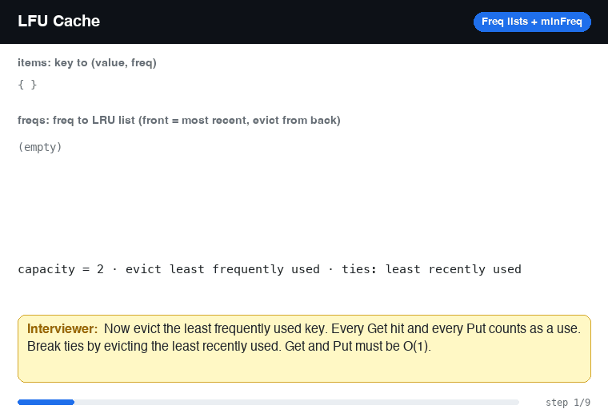

# Walkthrough: LFU Cache

**Module:** [20 · Design Problems](../README.md) · **Difficulty:** Hard · **Solution:** [`p07_lfu_cache.go`](../p07_lfu_cache.go)



## The problem in plain words

A cache with fixed room that throws out the key used the fewest times. If several keys tie on the fewest uses, it throws out the one used longest ago.

```
capacity 2:
Put(1,1) Put(2,2) Get(1)   freq: 1→2, 2→1
Put(3,3)                   evicts 2 (lowest freq)
Get(3)                     freq: 1→2, 3→2
Put(4,4)                   tie at freq 2: evicts 1 (older use)
```

## Mock interview

**Interviewer:** Design an LFU cache. Every `Get` hit and every `Put` counts as a use. Evict the least frequently used key, and break ties by least recent use. `Get` and `Put` must be O(1).

**Candidate:** Questions: does updating an existing key count as a use? What happens with capacity 0? Is it concurrent?

**Interviewer:** Yes, an update counts. Capacity 0 stores nothing. Yes, many goroutines.

**Candidate:** In the example, after `Get(1)`, key 1 has frequency 2 and key 2 has 1. So `Put(3,3)` evicts 2. After `Get(3)`, keys 1 and 3 both have frequency 2. Key 1 was used longer ago, so `Put(4,4)` evicts 1.

**Candidate:** The simple way stores a counter per key and scans for the minimum on each eviction: O(n). A heap ordered by `(freq, lastUse)` is O(log n), but every `Get` changes a key's position, so it needs updates on reads too.

**Interviewer:** How do you get O(1)?

**Candidate:** I group keys by frequency. `freqs` maps each frequency to an LRU-ordered list of the keys with that frequency, most recent at the front. `items` maps each key to its node, which holds the value and its frequency. And I track `minFreq`, the smallest frequency with a non-empty list.

**Candidate:** A use of a key, which I call `touch`, removes its node from list `f` and pushes it to the front of list `f + 1`. If list `f` became empty and `f` was `minFreq`, then `minFreq` becomes `f + 1`. That's correct because this node is now at `f + 1`, and nothing else was below it.

**Candidate:** Eviction takes the back of list `minFreq`: least frequent, and least recent among those. A new key always has frequency 1, so inserting sets `minFreq = 1`. I never have to search for the minimum.

**Candidate:** In Go, `LFUCache[K, V]` reuses the `node` and `dlist` types from the LRU cache. `touch` deletes empty lists from `freqs` so the map doesn't fill up with dead entries.

**Candidate:** Walking the example: `Put(1,1)` and `Put(2,2)` go into list 1, with 2 in front. `Get(1)` moves 1 to list 2. List 1 still holds 2, so `minFreq` stays 1. `Put(3,3)` is full, so I evict the back of list 1, which is 2, then add 3 to list 1. `Get(3)` moves 3 to list 2. List 1 is now empty and was `minFreq`, so `minFreq = 2`. `Put(4,4)` evicts the back of list 2, which is 1, because 3 is in front. Then 4 goes into list 1 and `minFreq = 1`.

**Interviewer:** Complexity?

**Candidate:** Each call is a few map lookups and list moves: **O(1) for `Get` and `Put`, O(capacity) space**.

**Interviewer:** How would this behave with many goroutines?

**Candidate:** One `sync.Mutex` guards every call. `Get` changes frequencies and moves nodes, so it's a write and can't use a read lock. Sharding by key would cut contention, but each shard would then evict by its own local frequencies, which is an approximation.

## What the animation shows

| Step | Call | Lists after (front → back) | `minFreq` | Result |
|---|---|---|---|---|
| 1 | — | — | — | Interviewer states the problem |
| 2 | — | — | — | Naive: scan O(n) or heap O(log n) |
| 3 | `Put(1,1)` | f1: 1 | 1 | — |
| 4 | `Put(2,2)` | f1: 2, 1 | 1 | — |
| 5 | `Get(1)` | f1: 2 · f2: 1 | 1 | 1 |
| 6 | `Put(3,3)` | f1: 3 · f2: 1 | 1 | evicts 2 |
| 7 | `Get(3)` | f2: 3, 1 | 2 | 3 |
| 8 | `Put(4,4)` | f1: 4 · f2: 3 | 1 | evicts 1 |
| 9 | — | — | — | Complexity and locking |

## Detailed explanation

The structure keeps three invariants. *Every key in `items` is in exactly one list, the one for its frequency.* *Each list is ordered by last use, front to back.* *`minFreq` is the smallest frequency with a non-empty list,* whenever the cache isn't empty.

`touch` keeps the first two by moving a node from list `f` to the front of list `f + 1`. For the third: frequencies only grow by one at a time, so if the touched node was the last at `minFreq`, it's now at `minFreq + 1`, and no other key can be lower. The only other change to the minimum is inserting a new key, which always has frequency 1, so `Put` sets `minFreq = 1`.

Eviction happens before the insert. At that point `minFreq` is accurate, so `freqs[minFreq].back()` is the correct victim.

Edge cases: capacity 0 returns from `Put` at once. `Put` on an existing key updates the value and touches it, without evicting.

## Complexity

| Operation | Time | Space |
|---|---|---|
| `LFUCache.Get` | O(1) | O(capacity) total |
| `LFUCache.Put` | O(1) | — |
| `LFUCache.Len` | O(1) | — |

## Common mistakes

- Searching for the new minimum frequency after a touch, instead of using `minFreq + 1`.
- Forgetting to reset `minFreq = 1` when a new key is inserted.
- Evicting from the front of the list, which removes the most recent key instead of the least recent.
- Not counting `Put` on an existing key as a use.

## Try it yourself

```sh
go test ./course/20-design-problems/ -run TestLFUCache -v
```
