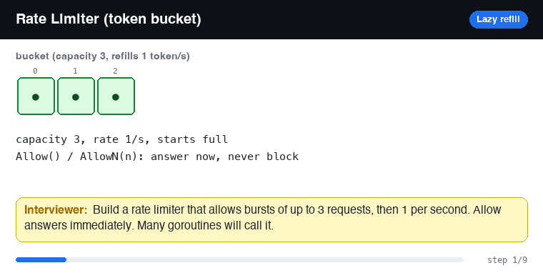

# Walkthrough: Rate Limiter (token bucket)

**Module:** [20 · Design Problems](../README.md) · **Difficulty:** Medium · **Solution:** [`p08_rate_limiter.go`](../p08_rate_limiter.go)



## The problem in plain words

Let requests through quickly in short bursts, but limit the long-run rate. Picture a jar holding up to `capacity` tokens that refills at `rate` tokens per second. Each request takes a token. If the jar is empty, the request is refused right away.

```
capacity 3, rate 1/s, starts full:
t=0.0s  Allow ×4  → true true true false   (burst used up)
t=1.0s  Allow     → true                   (one token refilled)
t=10s   AllowN(5) → false                  (bucket caps at 3)
```

## Mock interview

**Interviewer:** Build a rate limiter that allows bursts of up to `capacity` requests and sustains `rate` per second. `Allow` must answer immediately. Many goroutines will call it.

**Candidate:** Questions: should a refused request wait, or just get false? Does the bucket start full? Should I support asking for several tokens at once? How will we test it without sleeping?

**Interviewer:** Return false, don't block. It starts full. Yes, `AllowN(n)`, all or nothing. And tests shouldn't sleep.

**Candidate:** With capacity 3 and rate 1 per second, three requests at time 0 pass and the fourth fails. One second later there's one new token. After a long pause the bucket holds at most 3, so `AllowN(5)` fails.

**Candidate:** One design runs a ticker goroutine that adds a token every second. It works, but each limiter needs its own goroutine, it has to be stopped, and tests depend on real time.

**Interviewer:** What would you do instead?

**Candidate:** Refill lazily. On each call I compute how much time passed since the last call and add `elapsed × rate` tokens, capped at capacity. Then, if `tokens ≥ n`, I subtract `n` and allow. No background work is needed: the bucket only updates when someone asks.

**Candidate:** For tests, I inject the clock. `NewTokenBucket(capacity, rate, now)` takes a `func() time.Time`. Production passes `time.Now`; tests pass a fake clock they advance by hand.

**Candidate:** In code, `refill` computes `now.Sub(b.last).Seconds()`. It ignores negative elapsed time in case the clock goes backwards. `AllowN` locks the mutex, calls `refill`, then checks and spends. `Allow` is `AllowN(1)`. Tokens are `float64`, so partial refills add up.

**Candidate:** Walking the example: at t = 0 the bucket has 3. Three `Allow` calls take it to 2, 1, 0. The fourth sees 0 and returns false. At t = 1, refill adds 1 token, and the call spends it. At t = 10, refill would add 9, but the cap keeps it at 3. `AllowN(5)` needs 5, so it returns false and spends nothing.

**Interviewer:** Complexity?

**Candidate:** **O(1) time per call and O(1) space** per bucket.

**Interviewer:** How would this behave with many goroutines?

**Candidate:** Refill, check and spend must happen as one step. If two goroutines both read 1 token and both spend it, I'd allow two requests for one token. So all three run under one `sync.Mutex`. Two separate atomic operations wouldn't be enough. The tests run with `-race` to check this.

## What the animation shows

| Step | Time | Call | Tokens after | Result |
|---|---|---|---|---|
| 1 | — | — | 3 | Interviewer states the problem |
| 2 | — | — | 3 | Naive: ticker goroutine |
| 3 | 0s | `Allow()` | 2 | true |
| 4 | 0s | `Allow()` | 1 | true |
| 5 | 0s | `Allow()` | 0 | true |
| 6 | 0s | `Allow()` | 0 | false |
| 7 | 1s | `Allow()` (refill +1) | 0 | true |
| 8 | 10s | `AllowN(5)` (refill capped at 3) | 3 | false |
| 9 | — | — | — | Formula, complexity, locking |

## Detailed explanation

The invariant is: *after `refill`, `tokens` equals what a bucket refilling continuously at `rate` since the last call would hold, capped at `capacity`.* Lazy refill gives the same answers as a ticker, because nobody can observe the bucket between calls.

The cap matters. Without `min(capacity, ...)`, a long idle period would let a huge burst through later.

`last` only moves forward when elapsed time is positive. If the clock jumps backwards, the code adds nothing and keeps the old `last`, so it can't hand out extra tokens.

`AllowN` is all or nothing. If there aren't enough tokens, it spends none. Partial spending would let a large request drain the bucket and still be refused.

Edge cases: a burst of exactly `capacity` passes. `AllowN(n)` with `n > capacity` can never pass. Calls at the same instant add no tokens.

## Complexity

| Operation | Time | Space |
|---|---|---|
| `TokenBucket.Allow` / `AllowN` | O(1) | O(1) |
| `TokenBucket.Tokens` | O(1) | O(1) |

## Common mistakes

- Forgetting the cap, so tokens pile up during idle time.
- Using integer tokens, which loses fractional refills at slow rates.
- Doing refill and spend under separate locks or atomics, which lets two goroutines spend one token.
- Calling `time.Now()` directly, which makes tests slow and flaky.

## Try it yourself

```sh
go test ./course/20-design-problems/ -run TestTokenBucket -race -v
```
