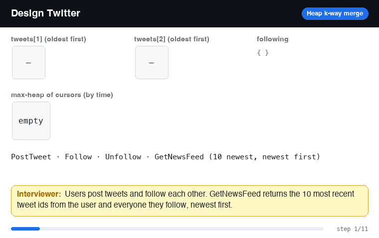

# Walkthrough: Design Twitter

**Module:** [20 · Design Problems](../README.md) · **Difficulty:** Medium · **Solution:** [`p09_design_twitter.go`](../p09_design_twitter.go)



## The problem in plain words

A tiny social network. Users post tweets and follow each other. A user's news feed is the 10 newest tweets from themselves and the people they follow, newest first.

```
PostTweet(1, 5); GetNewsFeed(1) → [5]
Follow(1, 2); PostTweet(2, 6); GetNewsFeed(1) → [6 5]
Unfollow(1, 2); GetNewsFeed(1) → [5]
```

## Mock interview

**Interviewer:** Implement `PostTweet`, `Follow`, `Unfollow` and `GetNewsFeed`. The feed returns up to 10 tweet ids from the user and their followees, newest first.

**Candidate:** Questions: are tweet ids unique? Can two tweets have the same time? Is following yourself allowed? What does unfollowing someone you don't follow do? Is it concurrent?

**Interviewer:** Ids are unique. Order by posting order. You always see your own tweets. Unfollowing a stranger does nothing. Yes, concurrent, with many more feed reads than posts.

**Candidate:** In the example, after user 1 follows user 2 and user 2 posts tweet 6, user 1's feed is `[6, 5]`, because 6 is newer. After unfollowing, only `[5]` is left.

**Candidate:** The simple feed gathers every tweet from the user and all followees, sorts them by time, and takes 10. That's O(T log T) for T tweets, even though I only need 10.

**Interviewer:** How do you avoid sorting everything?

**Candidate:** Each user's tweets are appended in posting order, so each list is already sorted. The feed is a merge of f sorted lists, and I only need the top 10. That's a k-way merge with a heap.

**Candidate:** I put one cursor per user, pointing at their newest tweet, into a max-heap keyed by time. I pop the top tweet into the feed. If that user has an older tweet, I move the cursor back one and sift it down. Otherwise I remove the cursor. I stop after 10 tweets or when the heap is empty.

**Candidate:** For times, a global counter `clock` goes up on every post. It gives a total order, so there are no ties.

**Candidate:** In Go, `tweets` is `map[int][]tweet`, oldest first. `following` is `map[int]map[int]struct{}`. `cursorHeap` implements `heap.Interface`. I build the heap with `heap.Init`, which is O(f). Instead of pop and push, I change the top cursor in place and call `heap.Fix(&h, 0)`.

**Candidate:** Walking the example: `PostTweet(1, 5)` appends `(5, t1)`. The feed has one cursor, so it's `[5]`. `Follow(1, 2)` adds 2 to user 1's set. `PostTweet(2, 6)` appends `(6, t2)`. The feed starts with cursors at `6@t2` and `5@t1`. Pop 6: user 2 has nothing older, so that cursor leaves. Pop 5: user 1 has nothing older. The feed is `[6, 5]`. After `Unfollow(1, 2)`, only user 1's list is merged: `[5]`.

**Interviewer:** Complexity?

**Candidate:** **`PostTweet`, `Follow` and `Unfollow` are O(1). `GetNewsFeed` is O(f + 10 log f)** for f followees. Space is O(users + tweets + follows).

**Interviewer:** How would this behave with many goroutines?

**Candidate:** A `sync.RWMutex` guards the maps. `GetNewsFeed` only reads, so many feeds build in parallel under the read lock. Posts and follows take the write lock. At large scale, this is "fan-out on read". The alternative, "fan-out on write", pushes each tweet into followers' stored timelines. It makes reads cheap but writes expensive for users with many followers.

## What the animation shows

| Step | Call | Heap after (top first) | Result |
|---|---|---|---|
| 1 | — | — | Interviewer states the problem |
| 2 | — | — | Naive: gather and sort all tweets |
| 3 | `PostTweet(1, 5)` | — | tweets[1] = 5@t1 |
| 4 | `GetNewsFeed(1)` | empty | `[5]` |
| 5 | `Follow(1, 2)` | — | following[1] = {2} |
| 6 | `PostTweet(2, 6)` | — | tweets[2] = 6@t2 |
| 7 | `GetNewsFeed(1)`: heap init | u2:6@t2, u1:5@t1 | — |
| 8 | pop 6 | u1:5@t1 | feed `[6]` |
| 9 | pop 5 | empty | `[6 5]` |
| 10 | `Unfollow(1, 2)`; `GetNewsFeed(1)` | empty | `[5]` |
| 11 | — | — | Complexity and locking |

## Detailed explanation

The heap holds at most one cursor per user. The invariant is: *each cursor points at the newest tweet from that user that isn't in the feed yet, and the heap's top has the newest time of all of them.* So the top is always the next tweet for the feed. Moving the cursor back one tweet keeps the invariant, and `heap.Fix` restores the heap order in O(log f).

Building the heap with `heap.Init` on all f cursors is O(f), faster than f separate pushes. After that, each of the at most 10 pops costs O(log f).

`Follow` ignores a user following themselves, because the feed always includes the user's own tweets. `Unfollow` uses `delete` on the inner map, which is a no-op if the user never followed, or if the inner map is nil.

Edge cases: a user with no tweets adds no cursor. A user who follows nobody gets a merge of one list. Fewer than 10 tweets in total gives a shorter feed.

## Complexity

| Operation | Time | Space |
|---|---|---|
| `Twitter.PostTweet` | O(1) amortized | O(1) per tweet |
| `Twitter.Follow`, `Unfollow` | O(1) | O(1) per follow |
| `Twitter.GetNewsFeed` | O(f + 10·log f) | O(f) for the heap |

## Common mistakes

- Sorting all tweets on every feed request.
- Forgetting the user's own tweets in their feed.
- Using real wall-clock time, so two tweets in the same instant tie.
- Pushing every tweet of every followee into the heap, instead of one cursor per user.

## Try it yourself

```sh
go test ./course/20-design-problems/ -run TestTwitter -v
```
